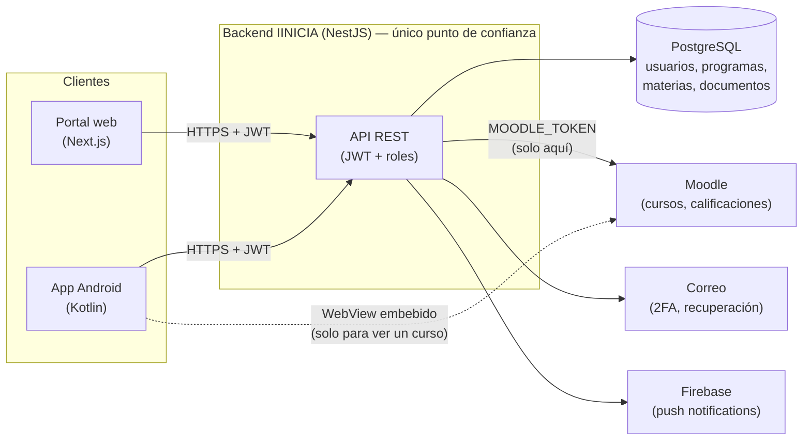
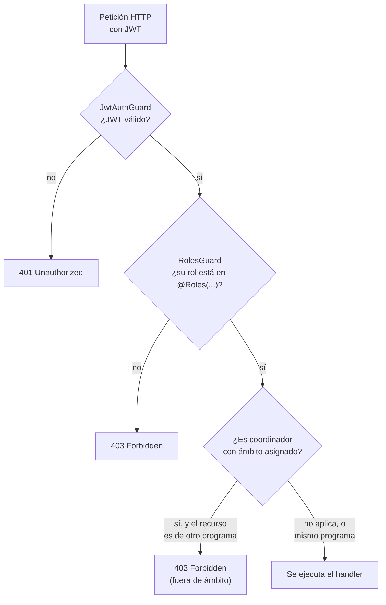
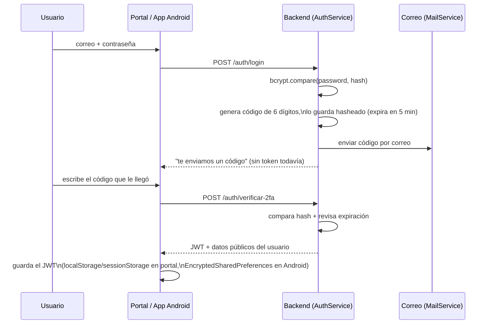
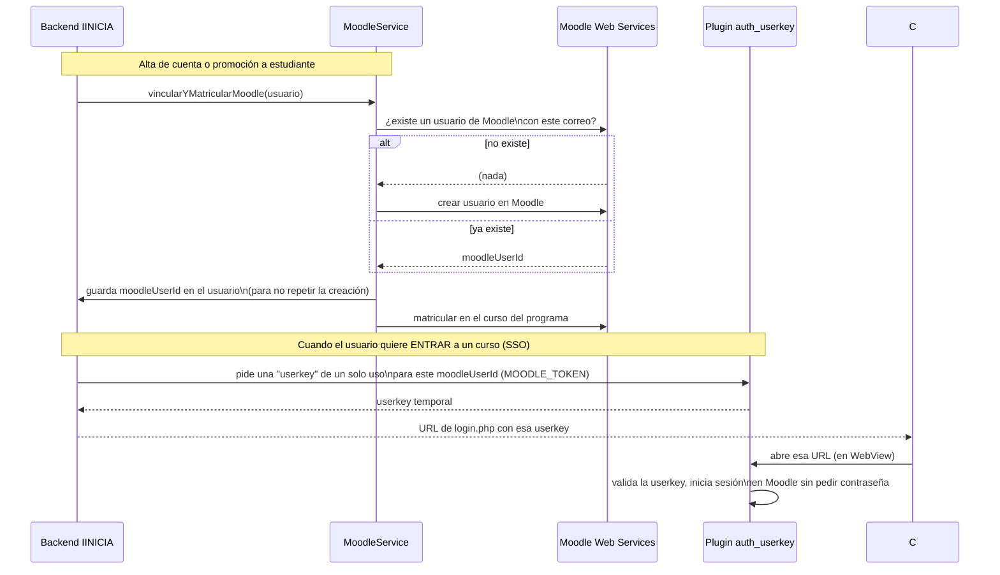

# Arquitectura general de IINICIA

Este documento explica, de un vistazo, cómo está armado todo el sistema: qué piezas existen,
cómo se hablan entre sí y por qué está diseñado así. Está pensado para alguien que nunca ha
visto el proyecto. Para el detalle de un archivo de código en concreto, ve a
[`docs/codigo-explicado/`](codigo-explicado/README.md).

## 1. Qué es IINICIA

Una plataforma universitaria con cuatro piezas que se despliegan por separado:

| Pieza | Tecnología | Para qué |
|---|---|---|
| **Portal web** (`frontend/`) | Next.js + TypeScript + Tailwind | Lo que usan aspirantes, estudiantes, profesores, coordinadores y administradores desde el navegador |
| **Backend / BFF** (`backend/`) | NestJS + PostgreSQL + JWT | La única pieza con permiso para hablar con Moodle y con la base de datos. Valida todos los permisos |
| **Moodle** (`infrastructure/moodle-src/` + plugin propio) | PHP, de terceros | El motor de cursos real (contenidos, calificaciones, actividades) |
| **App Android** (`android/`) | Kotlin + Jetpack Compose | Lo mismo que el portal, pero en el celular |

La regla de oro del proyecto (está en `CLAUDE.md`) es: **ni el portal ni la app Android hablan
directo con Moodle, ni conocen su token**. Todo pasa por el backend. Moodle es una pieza interna,
como si fuera "otra base de datos" — el usuario nunca la ve directamente (excepto dentro de un
WebView embebido para ver el contenido de un curso).

## 2. Roles y permisos

Seis roles, definidos en `backend/src/users/rol.enum.ts`:
`superadmin`, `admin_academico`, `coordinador`, `profesor`, `estudiante`, `aspirante`.

Regla clave (también de `CLAUDE.md`): **los permisos se validan en el backend, no solo en la
interfaz**. El portal/Android pueden ocultar un botón, pero si alguien llama al endpoint
directo sin tener el rol correcto, el backend igual lo rechaza. Esto se hace con dos piezas que
se combinan en cada ruta:

- `JwtAuthGuard` — ¿tiene una sesión válida (JWT firmado por este backend)?
- `RolesGuard` + `@Roles(...)` — ¿su rol está en la lista permitida para esta ruta?

Para `coordinador` hay una capa extra: un coordinador puede tener un **ámbito** (un programa
académico asignado). Si lo tiene, solo puede ver/actuar sobre usuarios y documentos de ese
programa — lo revisa `verificarAmbitoCoordinador` (`backend/src/auth/ambito-coordinador.ts`).
Este chequeo se añadió tras una auditoría de seguridad que encontró que dos rutas nuevas se
habían olvidado de aplicarlo (ver `docs/codigo-explicado/backend/auth/ambito-coordinador.md`).

## 3. Cómo se inicia sesión (login con 2 factores)

Desde la auditoría de seguridad de 2026-11-25, el login con Google se reemplazó por
correo + contraseña + un código de 6 dígitos por correo (2FA propio, sin depender de un
proveedor externo). El flujo es el mismo en portal y Android, contra el mismo backend:

Detalle que no es obvio: el primer paso (`login`) compara contra un hash "de relleno"
(`DUMMY_HASH`) cuando el correo no existe, para que un correo inexistente tarde el mismo tiempo
en responder que uno real que no es el suyo — evita que alguien adivine qué correos están
registrados por la diferencia de tiempo de respuesta.

## 4. Cómo se conecta con Moodle (idempotente, sin tocar su core)

Dos reglas de `CLAUDE.md` definen esta pieza: **no se modifica el core de Moodle** (se usa un
plugin propio, `infrastructure/moodle-custom/auth/userkey/`) y **la integración es idempotente**
(un usuario de IINICIA se vincula a lo mucho una vez a un usuario de Moodle, vía
`moodleUserId` guardado en la fila del usuario — llamar la vinculación dos veces no crea
cuentas duplicadas).

Esta vinculación **nunca lanza un error hacia el usuario**: si Moodle no responde, la cuenta de
IINICIA se crea igual (con `moodleUserId` en null) y queda para reintentarse después — ver
`backend/src/moodle/moodle-onboarding.ts`.

## 5. Dónde vive cada cosa (mapa de módulos)

| Módulo backend | Qué resuelve | Doc |
|---|---|---|
| `auth/` | Login, 2FA, recuperación, guards de rol/ámbito | [codigo-explicado/backend/auth](codigo-explicado/backend/index.md) |
| `users/` + `usuarios/` | CRUD de usuarios, cambio de rol, ámbito del coordinador | idem |
| `documentos/` | Subida/descarga de documentos de admisión | idem |
| `materias/` | Seriación (prerrequisitos) de materias | idem |
| `programas/` | Programas académicos y su curso de Moodle asociado | idem |
| `moodle/` | Cliente de Moodle Web Services, vinculación idempotente | idem |
| `mail/`, `push/` | Correo (2FA, recuperación) y notificaciones push | idem |

Portal (`frontend/`), app Android (`android/`) y la infraestructura (`infrastructure/`) tienen
su propio índice de documentos en:
- [`codigo-explicado/frontend/index.md`](codigo-explicado/frontend/index.md)
- [`codigo-explicado/android/index.md`](codigo-explicado/android/index.md)
- [`codigo-explicado/infrastructure/index.md`](codigo-explicado/infrastructure/index.md)

## 6. Seguridad, en una frase

El sistema pasó por una auditoría de vulnerabilidades (74 → 96/100): se corrigieron dos fallas
de control de acceso (un coordinador podía ver documentos de otro programa; cualquier
profesor/coordinador podía mandar una notificación push a cualquier usuario) y se endurecieron
`npm audit`, CSP, CORS, rate limiting y Dependabot/CodeQL. El detalle completo vive en
`presentacion/SEGURIDAD/`.

## 7. Qué NO hace el sistema todavía

- No hay SSO con Keycloak (mencionado en `docs/requerimientos.md` como plan futuro); por ahora
  la sesión del portal vive en `localStorage`/`sessionStorage` del navegador.
- La revisión del plugin Moodle (`auth_userkey`) es estática, no un pentest dedicado al flujo
  SSO completo.
