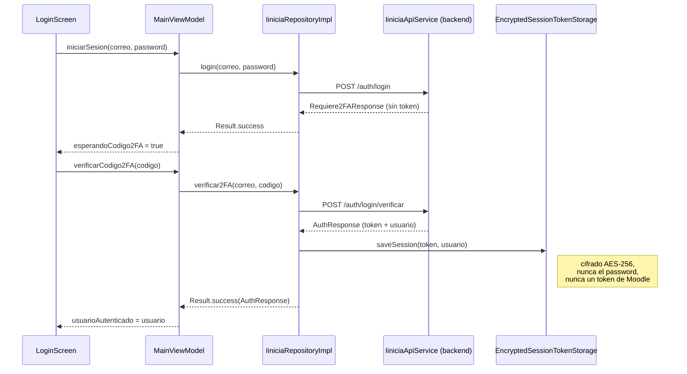

# `android/app/src/main/java/org/iinicia/android/data/repository/IiniciaRepository.kt`

**En una frase:** es la capa intermedia entre la UI/ViewModel y la red: decide cómo llamar al backend, cómo convertir sus respuestas crudas a modelos de dominio, y qué hacer cuando algo falla (incluida la sesión expirada).

## Por qué existe

Sin esta capa, el `MainViewModel` tendría que llamar directo a `IiniciaApiService`, manejar excepciones HTTP, parsear mensajes de error JSON, y decidir cuándo limpiar la sesión — todo mezclado con la lógica de estado de la UI. El patrón "Repository" separa esa responsabilidad: el ViewModel solo pide "dame el dashboard" o "haz login" y recibe un `Result<T>` limpio (éxito o fallo con un mensaje ya en español), sin saber nada de HTTP, JSON ni tokens.

## Recorrido del código

```kotlin
/** El JWT expiró (401): el repositorio ya limpió la sesión persistida; quien la reciba
 * debe reflejarlo en el estado de UI (ver MainViewModel.cerrarSesion). */
class SesionExpiradaException : Exception("Tu sesión expiró. Vuelve a iniciar sesión.")
```

Es una excepción propia (no una genérica) para que quien la reciba (el `MainViewModel`) pueda distinguir "la sesión expiró, hay que mandar a Login" de cualquier otro error de red, sin tener que comparar códigos HTTP otra vez en la capa de arriba.

```kotlin
private fun CursoInscritoDto.aCursoEstudiante(): CursoEstudiante = CursoEstudiante(
    id = id.toString(),
    nombre = nombre,
    periodo = shortname,
    progreso = progreso,
    estado = EstadoCurso.desdeProgreso(progreso),
    docente = "",
    descripcion = "",
)
```

Esta función de extensión es el único lugar donde se traduce "lo que Moodle realmente expone" a "lo que la UI espera mostrar". El comentario del código es explícito: como Moodle no manda `docente` ni `descripcion` en este endpoint, esos campos se dejan vacíos en vez de rellenarlos con algo inventado — mostrar un dato falso como si fuera real sería peor que no mostrarlo.

```kotlin
class IiniciaRepositoryImpl(
    override val baseUrl: String = ApiConfig.DEFAULT_BASE_URL,
    private val tokenStorage: SessionTokenStorage = InMemorySessionTokenStorage(),
    override val isConnectToRemoteEnabled: Boolean = true,
    private val apiService: IiniciaApiService = RetrofitClient.createApiService(
        baseUrl = baseUrl,
        tokenProvider = { tokenStorage.getToken() }
    )
) : IiniciaRepository {
```

Todos los parámetros tienen un valor por defecto que apunta al comportamiento "real" (habla con la red, usa `ApiConfig.DEFAULT_BASE_URL`). Esto permite instanciar `IiniciaRepositoryImpl()` sin argumentos en producción (como hace `MainActivity`, pasando solo `tokenStorage`), y al mismo tiempo sustituir cualquier pieza (`apiService`, `tokenStorage`, `isConnectToRemoteEnabled = false`) en pruebas unitarias sin tocar la clase.

```kotlin
    private suspend fun <T> conSesion(block: suspend () -> T): Result<T> {
        return try {
            Result.success(block())
        } catch (cancellation: CancellationException) {
            throw cancellation
        } catch (httpException: HttpException) {
            if (httpException.code() == 401) {
                tokenStorage.clearSession()
                return Result.failure(SesionExpiradaException())
            }
            ...
        } catch (e: Exception) {
            ...
        }
    }
```

`conSesion` es el envoltorio común para cualquier llamada que requiere sesión activa (cursos, actividades, SSO a Moodle). Tres detalles importantes:
- `CancellationException` se relanza (`throw`, no se convierte en `Result.failure`): es la señal interna de corutinas de Kotlin para "esta tarea fue cancelada" (p. ej. el usuario navegó a otra pantalla); tragarla como si fuera un error normal rompería la cancelación cooperativa de corutinas.
- Un 401 (no autorizado) se trata como un caso especial: limpia la sesión guardada de inmediato (ya no sirve) y devuelve `SesionExpiradaException`, en vez de mostrar un mensaje HTTP crudo al usuario.
- Cualquier otro error HTTP intenta extraer el mensaje real que mandó el backend (ver `parseErrorMessage`) en vez de mostrar algo como "HTTP 400".

```kotlin
    override suspend fun verificar2FA(correo: String, codigo: String): Result<AuthResponse> {
        return try {
            val response = if (isConnectToRemoteEnabled) {
                apiService.verificar2FA(Verificar2FARequest(correo = correo.trim(), codigo = codigo))
            } else {
                delay(300)
                MockDataSource.buildMockAuthResponse(correo = correo.trim())
            }
            // `tokenStorage` persiste esto en EncryptedSharedPreferences...
            // PROHIBIDO almacenar `password` en texto plano o guardar tokens de Moodle.
            tokenStorage.saveSession(response.token, response.usuario)
            Result.success(response)
        } catch (...) { ... }
    }
```

Este es el único método de todo el repositorio que llama `tokenStorage.saveSession(...)`: la sesión **solo** se guarda tras el segundo factor exitoso, nunca tras el primer paso de `login`. Esto refuerza en código la regla de negocio: el primer factor correcto no es suficiente para considerar al usuario autenticado.

```kotlin
    override suspend fun getDashboardEstudiante(): Result<DashboardEstudiante> {
        return conSesion {
            val usuario = tokenStorage.getUsuario() ?: MockDataSource.mockUsuarioEstudiante
            val cursos = if (isConnectToRemoteEnabled) {
                apiService.getCursos().map { it.aCursoEstudiante() }
            } else {
                emptyList()
            }
            val actividades = if (isConnectToRemoteEnabled) {
                runCatching { apiService.getActividadesProximas() }.getOrDefault(emptyList())
            } else {
                emptyList()
            }
            DashboardEstudiante(...)
        }
    }
```

Nótese que si `getActividadesProximas()` falla, el error se absorbe con `runCatching { }.getOrDefault(emptyList())` **dentro** de este método — no se propaga como un fallo del dashboard completo. La razón (explicada en el comentario del código fuente) es de prioridad: los cursos son la información esencial del dashboard; las "próximas actividades" son un extra secundario, así que un problema ahí no debe impedir ver los cursos.

```kotlin
    companion object {
        fun parseErrorMessage(rawErrorBody: String?, fallbackMessage: String): String {
            if (rawErrorBody.isNullOrBlank()) return fallbackMessage
            return try {
                val jsonObject = JsonParser.parseString(rawErrorBody).asJsonObject
                val messageElement = jsonObject.get("message") ?: return fallbackMessage
                val extracted = when {
                    messageElement.isJsonPrimitive -> messageElement.asString
                    messageElement.isJsonArray && messageElement.asJsonArray.size() > 0 ->
                        messageElement.asJsonArray[0].asString
                    else -> null
                }
                extracted?.takeIf { it.isNotBlank() } ?: fallbackMessage
            } catch (_: Exception) {
                fallbackMessage
            }
        }
    }
```

NestJS, cuando falla una validación, a veces manda `message` como un string y a veces como un arreglo de strings (un mensaje por campo inválido). Esta función cubre ambos casos y, si el cuerpo no es JSON válido o no tiene el campo esperado, cae de vuelta al mensaje genérico (`fallbackMessage`) en vez de mostrar algo roto o un stacktrace al usuario.

## Diagrama: login en dos factores hasta guardar sesión



## Conexión con el resto del sistema

- Depende de `IiniciaApiService` (vía `RetrofitClient`) para toda llamada de red real.
- Depende de `SessionTokenStorage` (en producción, `EncryptedSessionTokenStorage`) para leer/guardar el JWT y el `Usuario`.
- Usa `MockDataSource` únicamente cuando `isConnectToRemoteEnabled = false`.
- `MainViewModel` es el único consumidor de `IiniciaRepository`: ninguna pantalla llama a este repositorio directamente.

## Cosas que no son obvias a primera vista

- Un 401 en cualquier llamada envuelta en `conSesion` dispara una limpieza de sesión automática (`tokenStorage.clearSession()`) **antes** de que el ViewModel se entere — el repositorio no espera a que la capa superior decida qué hacer con la sesión inválida.
- El repositorio nunca ve ni procesa la contraseña después de enviarla al backend: no hay ningún campo ni variable que la retenga más allá de la llamada HTTP misma.
- `getUrlCampus` (usado para el SSO hacia Moodle) también está envuelto en `conSesion`, así que si el JWT ya expiró, pedir entrar al campus también fuerza un logout limpio en vez de mostrar un error de Moodle confuso.
