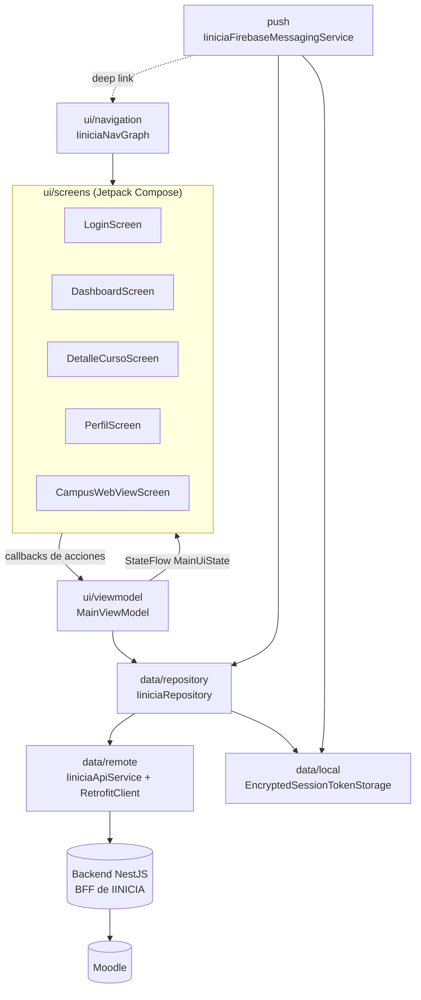

# Código explicado — App Android IINICIA

Documentación en español, pensada para alguien sin conocimiento previo del sistema, de cada
archivo con lógica real de la app Android (Kotlin + Jetpack Compose) de IINICIA. Cada `.md`
explica qué hace el archivo, por qué está hecho así, con qué otras piezas del sistema conecta y
qué decisiones no son obvias a primera vista. Ver `CLAUDE.md` en la raíz del repo para las
reglas generales del proyecto (roles, integración con Moodle, manejo de tokens).

## Punto de entrada

- [MainActivity](MainActivity.md) — arranca la app, pide el permiso de notificaciones y resuelve el deep link de una notificación push tocada.

## data/local

- [SessionTokenStorage](data/local/SessionTokenStorage.md) — el contrato de "guardar sesión" y una implementación en memoria solo para pruebas/previews.
- [EncryptedSessionTokenStorage](data/local/EncryptedSessionTokenStorage.md) — la implementación real: JWT y perfil cifrados en disco con el Android Keystore.
- [MockDataSource](data/local/MockDataSource.md) — datos de ejemplo (usuario, cursos, avisos) usados solo cuando el repositorio corre en modo sin red real.

## data/remote

- [ApiConfig](data/remote/ApiConfig.md) — URL base del backend y tiempos de espera de red, centralizados en un solo lugar.
- [RetrofitClient](data/remote/RetrofitClient.md) — construye el cliente HTTP, incluyendo el interceptor que agrega el JWT y el que filtra qué se escribe en los logs.
- [IiniciaApiService](data/remote/IiniciaApiService.md) — el contrato completo de endpoints del backend que la app puede llamar.

## data/model

- [Models](data/model/Models.md) — todas las estructuras de datos (roles, usuario, cursos, peticiones/respuestas de red) que fluyen entre capas.

## data/repository

- [IiniciaRepository](data/repository/IiniciaRepository.md) — la capa que conecta la red con la UI: login en dos factores, conversión de datos crudos de Moodle, manejo de sesión expirada y de errores en español.

## ui/viewmodel

- [MainViewModel](ui/viewmodel/MainViewModel.md) — todo el estado de la UI en un único `StateFlow`, y las acciones (login, 2FA, cargar cursos, cerrar sesión, notificaciones) que las pantallas pueden disparar.

## ui/screens

- [LoginScreen](ui/screens/LoginScreen.md) — login en dos pasos: correo/contraseña y luego el código de verificación.
- [DashboardScreen](ui/screens/DashboardScreen.md) — pantalla principal: bienvenida, lista de cursos reales y próximas actividades.
- [DetalleCursoScreen](ui/screens/DetalleCursoScreen.md) — detalle de un curso y el botón "Entrar al Campus" (SSO hacia Moodle).
- [PerfilScreen](ui/screens/PerfilScreen.md) — datos del usuario, interruptor de notificaciones push y cerrar sesión.
- [CampusWebViewScreen](ui/screens/CampusWebViewScreen.md) — la única pantalla con un `WebView`: Moodle ya autenticado, embebido dentro de la app.

## ui/components

- [ConfirmarCerrarSesionDialog](ui/components/ConfirmarCerrarSesionDialog.md) — diálogo de confirmación reutilizado antes de cerrar sesión.

## ui/navigation

- [IiniciaNavGraph](ui/navigation/IiniciaNavGraph.md) — define todas las pantallas y rutas, y conecta cada callback de la UI con el `MainViewModel`.

## push

- [IiniciaFirebaseMessagingService](push/IiniciaFirebaseMessagingService.md) — recibe los push de Firebase, respeta la preferencia de notificaciones del usuario y resuelve el deep link hacia un curso.

## Fuera de alcance (solo estilos)

Los archivos de tema visual `ui/theme/Color.kt`, `ui/theme/Theme.kt` y `ui/theme/Type.kt` no
tienen un `.md` propio: son boilerplate estándar de Jetpack Compose (paletas de color, tipografía
y el `MaterialTheme` que los combina), sin lógica de negocio que documentar.

## Arquitectura de capas

La regla que atraviesa todas las capas: ningún token de Moodle ni la contraseña del usuario viajan
más arriba de `IiniciaRepository`/`EncryptedSessionTokenStorage` — Android solo conoce el JWT propio
del backend de IINICIA.
