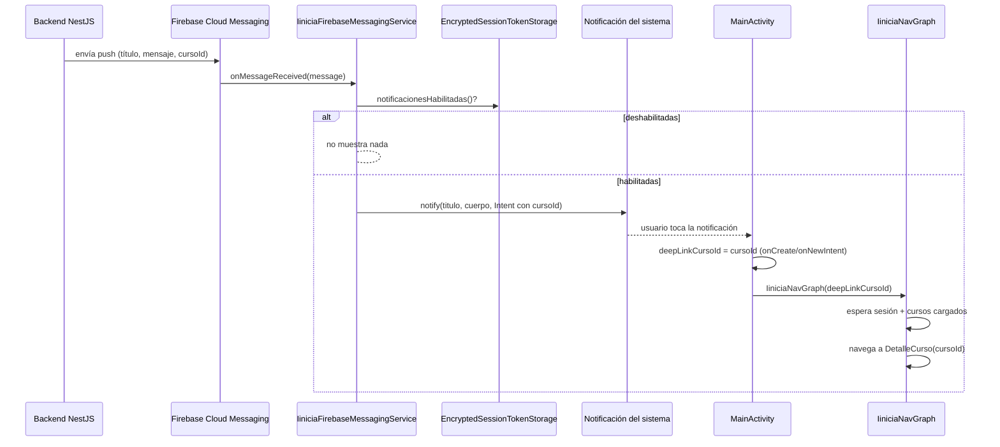

# `android/app/src/main/java/org/iinicia/android/push/IiniciaFirebaseMessagingService.kt`

**En una frase:** recibe las notificaciones push de Firebase Cloud Messaging, decide si debe mostrarlas (según la preferencia del usuario) y las convierte en una notificación nativa de Android que, al tocarse, puede abrir un curso específico.

## Por qué existe

El requerimiento 9.1 pide "notificaciones push para avisos académicos y eventos relevantes" con, idealmente, deep links hacia contenido específico. Android exige que cualquier app que reciba mensajes de Firebase Cloud Messaging (FCM) implemente un servicio heredando de `FirebaseMessagingService` — este archivo es ese punto de entrada obligatorio, y además es donde se decide toda la lógica de "qué hacer cuando llega un mensaje" (mostrarlo o no, con qué texto, a dónde debe llevar si se toca).

## Recorrido del código

```kotlin
/**
 * Recibe notificaciones push (Requerimiento 9.1: "notificaciones push para avisos académicos y
 * eventos relevantes"). Necesita un proyecto Firebase real (ver android/app/google-services.json
 * y backend/.env FIREBASE_SERVICE_ACCOUNT) para recibir algo de verdad; sin eso nunca se invoca.
 */
class IiniciaFirebaseMessagingService : FirebaseMessagingService() {
```

El comentario deja claro que este código por sí solo no hace nada si no hay un proyecto Firebase real configurado tanto en Android (`google-services.json`) como en el backend (quien es el que realmente envía los mensajes a través de la cuenta de servicio de Firebase). Es el código Android de un sistema de dos puntas.

```kotlin
    override fun onNewToken(token: String) {
        super.onNewToken(token)
        val repository = IiniciaRepositoryImpl(tokenStorage = EncryptedSessionTokenStorage(applicationContext))
        if (repository.getCurrentSessionUser() == null) return
        // shortcut: fire-and-forget sin reintentos; si falla, se reintentará en el próximo
        // onNewToken o login. Suficiente para esta fase sin backend de cola de reintentos.
        CoroutineScope(Dispatchers.IO).launch {
            repository.registrarTokenPush(token)
        }
    }
```

Android/Firebase pueden invocar `onNewToken` en cualquier momento, incluso antes de que exista una sesión de usuario (por ejemplo, recién instalada la app, antes del primer login). Por eso primero verifica `repository.getCurrentSessionUser() == null` y se sale si no hay sesión — no tiene sentido registrar un token push contra un usuario que no existe todavía; eso lo cubre `MainViewModel.registrarTokenPushActual()` justo después del login. Nótese que este servicio construye su **propia** instancia de `IiniciaRepositoryImpl`/`EncryptedSessionTokenStorage`: a diferencia de `MainActivity`, un `FirebaseMessagingService` lo instancia el sistema operativo directamente, así que no hay forma de inyectarle el mismo repositorio que usa el ViewModel — ambos simplemente leen/escriben el mismo almacenamiento cifrado en disco.

```kotlin
    override fun onMessageReceived(message: RemoteMessage) {
        super.onMessageReceived(message)
        val storage = EncryptedSessionTokenStorage(applicationContext)
        if (!storage.notificacionesHabilitadas()) return

        val titulo = message.notification?.title ?: message.data["titulo"] ?: "IINICIA"
        val cuerpo = message.notification?.body ?: message.data["mensaje"] ?: return
        mostrarNotificacion(titulo, cuerpo, message.data["cursoId"])
    }
```

Antes de hacer cualquier otra cosa, revisa `storage.notificacionesHabilitadas()` — la misma preferencia que el usuario controla desde `PerfilScreen`. Si está apagada, el mensaje llega pero nunca se muestra como notificación visible: Firebase sigue entregando el mensaje a la app (eso no se puede evitar sin desuscribirse del tema/token), pero la app decide no molestar al usuario. `message.notification` vs `message.data` cubre dos formas distintas en que FCM puede traer el contenido (notificación estructurada vs. datos crudos personalizados); si no hay cuerpo del mensaje en ninguna de las dos formas, la función se sale (`return`) sin mostrar nada en absoluto — no tiene sentido una notificación vacía.

```kotlin
    /**
     * `cursoId` (si el backend lo envió, ver UsuariosController.notificar) es el deep link:
     * tocar la notificación abre directo el detalle de ese curso en vez de solo el dashboard
     * (requerimientos 9.1: "deep links hacia contenidos o actividades específicas").
     */
    private fun mostrarNotificacion(titulo: String, cuerpo: String, cursoId: String?) {
        crearCanalSiNoExiste()
        val intent = Intent(this, MainActivity::class.java).apply {
            flags = Intent.FLAG_ACTIVITY_NEW_TASK or Intent.FLAG_ACTIVITY_CLEAR_TOP
            if (cursoId != null) putExtra(MainActivity.EXTRA_CURSO_ID, cursoId)
        }
        val pendingIntent = PendingIntent.getActivity(
            this,
            cursoId?.hashCode() ?: 0,
            intent,
            PendingIntent.FLAG_UPDATE_CURRENT or PendingIntent.FLAG_IMMUTABLE
        )
        val notificacion = NotificationCompat.Builder(this, CANAL_AVISOS_ID)
            .setSmallIcon(android.R.drawable.ic_dialog_info)
            .setContentTitle(titulo)
            .setContentText(cuerpo)
            .setAutoCancel(true)
            .setContentIntent(pendingIntent)
            .setPriority(NotificationCompat.PRIORITY_DEFAULT)
            .build()
        NotificationManagerCompat.from(this).notify(System.currentTimeMillis().toInt(), notificacion)
    }
```

El `cursoId` (si vino en el mensaje) se adjunta al `Intent` que se dispara al tocar la notificación, usando exactamente la misma constante `MainActivity.EXTRA_CURSO_ID` que `MainActivity` lee en `onCreate`/`onNewIntent` — así se cierra el círculo del deep link. `FLAG_ACTIVITY_NEW_TASK or FLAG_ACTIVITY_CLEAR_TOP` asegura que, si la app ya estaba abierta, no se cree una segunda instancia de `MainActivity` encima: se reutiliza la existente y se limpia cualquier pantalla que estuviera por encima. `PendingIntent.FLAG_IMMUTABLE` es obligatorio en versiones recientes de Android por seguridad (evita que otra app pueda modificar este `Intent` antes de que se dispare). El id de la notificación (`System.currentTimeMillis().toInt()`) es distinto cada vez, así que varias notificaciones push pueden coexistir en la bandeja del sistema sin sobrescribirse entre sí.

```kotlin
    private fun crearCanalSiNoExiste() {
        val manager = getSystemService(Context.NOTIFICATION_SERVICE) as NotificationManager
        if (manager.getNotificationChannel(CANAL_AVISOS_ID) != null) return
        manager.createNotificationChannel(
            NotificationChannel(CANAL_AVISOS_ID, "Avisos académicos", NotificationManager.IMPORTANCE_DEFAULT)
        )
    }
```

Desde Android 8 (Oreo), toda notificación necesita un "canal" creado de antemano, o el sistema la descarta silenciosamente. Esta función crea el canal una sola vez (revisa si ya existe antes de intentar crearlo de nuevo) la primera vez que haga falta, en vez de forzar su creación en el arranque de la app.

## Diagrama: de un push enviado por el backend a abrir un curso específico



## Conexión con el resto del sistema

- Construye sus propias instancias de `IiniciaRepositoryImpl` y `EncryptedSessionTokenStorage` (`data/repository/IiniciaRepository.kt`, `data/local/EncryptedSessionTokenStorage.kt`) porque el sistema operativo es quien instancia este servicio, no `MainActivity`.
- El `cursoId` que adjunta al `Intent` es leído por `MainActivity` (constante `EXTRA_CURSO_ID`) y resuelto finalmente por `IiniciaNavGraph` como un deep link hacia `DetalleCursoScreen`.
- El registro del token (`registrarTokenPush`) llama a `PATCH /estudiante/push-token` en el backend, a través de `IiniciaApiService`.

## Cosas que no son obvias a primera vista

- Este servicio puede ejecutarse con la app completamente cerrada (ni en segundo plano): Android lo despierta solo para procesar el mensaje de FCM. Por eso no puede depender de que exista un `MainViewModel` ya corriendo — todo lo que necesita (sesión, preferencia de notificaciones) lo lee directo del almacenamiento cifrado en disco.
- El comentario `shortcut: fire-and-forget sin reintentos` en `onNewToken` es una limitación reconocida del código: si el registro del token push falla por una red inestable justo en ese momento, no hay cola de reintentos — se confía en que un futuro `onNewToken` o login lo vuelva a intentar. Es aceptable para esta fase del proyecto, pero sería el primer lugar a revisar si se reportan dispositivos que "dejaron de recibir notificaciones".
- Nunca se guarda ni se procesa ningún dato de Moodle aquí: el único id relevante del lado de Moodle que viaja en el mensaje es `cursoId`, un entero que ya identifica un curso en el backend propio de IINICIA (mismo id que usa `CursoInscritoDto.id`).
