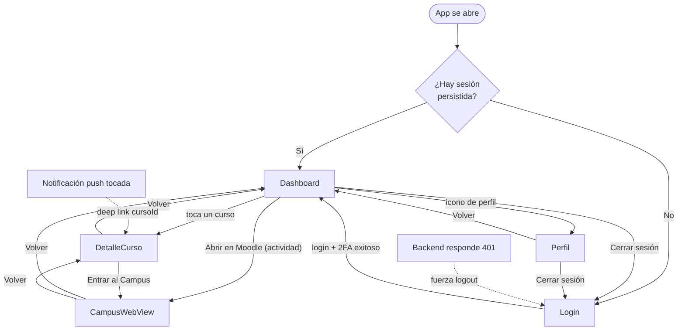

# `android/app/src/main/java/org/iinicia/android/ui/navigation/IiniciaNavGraph.kt`

**En una frase:** define todas las pantallas de la app y las rutas entre ellas, y es el único lugar que conecta los callbacks de cada pantalla con las funciones reales del `MainViewModel`.

## Por qué existe

Alguien tiene que decidir qué pantalla se ve primero, a dónde ir cuando se toca un botón, y qué hacer cuando ocurre algo fuera del flujo normal de toques del usuario (una sesión que expiró en segundo plano, una notificación push tocada mientras la app ya estaba abierta). `IiniciaNavGraph` centraliza toda esa coreografía usando Jetpack Navigation Compose, para que cada pantalla (`LoginScreen`, `DashboardScreen`, etc.) permanezca "tonta" — solo expone callbacks, sin saber a dónde navegar después.

## Recorrido del código

```kotlin
sealed class Screen(val route: String) {
    data object Login : Screen("login")
    data object Dashboard : Screen("dashboard")
    data object Perfil : Screen("perfil")
    data object CampusWebView : Screen("campus")
    data object DetalleCurso : Screen("curso/{cursoId}") {
        const val ARG_CURSO_ID = "cursoId"
        fun crearRuta(cursoId: String) = "curso/$cursoId"
    }
}
```

Una `sealed class` para las rutas evita escribir strings sueltos ("login", "dashboard", ...) repetidos por todo el código, con riesgo de un typo que rompa la navegación silenciosamente. `DetalleCurso.crearRuta(cursoId)` es la única forma "oficial" de construir esa ruta con un id real, para no tener que recordar el formato exacto (`"curso/$cursoId"`) en cada lugar que navega hacia el detalle.

```kotlin
    val initialDestination = remember {
        if (uiState.usuarioAutenticado != null) Screen.Dashboard.route else Screen.Login.route
    }
```

Como `MainViewModel` ya inicializa su estado leyendo `repository.getCurrentSessionUser()` (la sesión persistida en `EncryptedSessionTokenStorage`), si el usuario ya tenía sesión guardada de una apertura anterior, la app arranca directo en el Dashboard — nunca obliga a loguearse otra vez solo por reabrir la app.

```kotlin
    LaunchedEffect(Unit) {
        if (uiState.usuarioAutenticado != null && uiState.dashboard == null) {
            viewModel.cargarCursos()
        }
    }
```

Cubre exactamente el caso de sesión persistida: si ya hay usuario pero `dashboard` sigue vacío (nadie pidió los cursos todavía, porque el login "en caliente" ya dispara su propia carga en `MainViewModel.verificarCodigo2FA`), aquí se dispara esa carga. `LaunchedEffect(Unit)` significa "ejecútalo una sola vez cuando este `Composable` entra en pantalla".

```kotlin
    val currentBackStackEntry by navController.currentBackStackEntryAsState()
    LaunchedEffect(uiState.usuarioAutenticado, currentBackStackEntry) {
        if (uiState.usuarioAutenticado == null && currentBackStackEntry?.destination?.route != Screen.Login.route) {
            navController.navigate(Screen.Login.route) {
                popUpTo(0) { inclusive = true }
                launchSingleTop = true
            }
        }
    }
```

Este efecto reacciona a **cualquier** momento en que `usuarioAutenticado` se vuelva `null` mientras la app no está ya en Login — ya sea por un logout manual o, más importante, por un cierre de sesión forzado desde `MainViewModel.cerrarSesionSiExpiro` (cuando el backend respondió 401). `popUpTo(0) { inclusive = true }` borra TODO el historial de navegación anterior, para que el botón "atrás" desde Login no regrese a pantallas de una sesión que ya no existe.

```kotlin
    LaunchedEffect(deepLinkCursoId, uiState.usuarioAutenticado, uiState.cursos) {
        if (deepLinkCursoId != null && uiState.usuarioAutenticado != null && uiState.cursos.isNotEmpty()) {
            navController.navigate(Screen.DetalleCurso.crearRuta(deepLinkCursoId)) {
                launchSingleTop = true
            }
            onDeepLinkConsumido()
        }
    }
```

Este es el efecto que resuelve el deep link de una notificación push. Espera a que se cumplan **tres** condiciones a la vez: que exista un `deepLinkCursoId` pendiente, que haya sesión activa, y que los cursos ya estén cargados en memoria — si se navegara antes de que `uiState.cursos` tuviera datos, `DetalleCursoScreen` recibiría `curso = null` porque `obtenerCursoPorId` no encontraría nada todavía. Al cumplirse las tres, navega y llama `onDeepLinkConsumido()` para que `MainActivity` limpie el estado y no vuelva a disparar esta navegación en un recomposición futura.

## Diagrama: navegación completa y reacciones automáticas



## Conexión con el resto del sistema

- Es el único archivo que importa y compone todas las pantallas (`LoginScreen`, `DashboardScreen`, `DetalleCursoScreen`, `PerfilScreen`, `CampusWebViewScreen`).
- Recibe el `MainViewModel` ya construido desde `MainActivity`.
- Recibe `deepLinkCursoId` desde `MainActivity`, que a su vez lo obtiene del `Intent` generado por `IiniciaFirebaseMessagingService`.

## Cosas que no son obvias a primera vista

- La navegación hacia Login forzada por sesión expirada y la navegación hacia Login por logout manual usan rutas de código distintas (un `LaunchedEffect` reactivo vs. un `navController.navigate` directo en el callback `onLogout`), pero ambas terminan en el mismo lugar gracias a `launchSingleTop` — no se duplican pantallas de Login en la pila.
- El deep link de push tiene una ventana de espera implícita: si los cursos tardan en cargar (o fallan), la navegación hacia el detalle del curso simplemente no ocurre hasta que `uiState.cursos` tenga datos; no hay timeout ni mensaje de error para este caso específico.
- `CampusWebViewScreen` puede volver tanto a `Dashboard` como a `DetalleCurso` según desde dónde se haya entrado (gracias a `navController.popBackStack()`, que simplemente regresa a la pantalla anterior real en la pila, cualquiera que haya sido).
