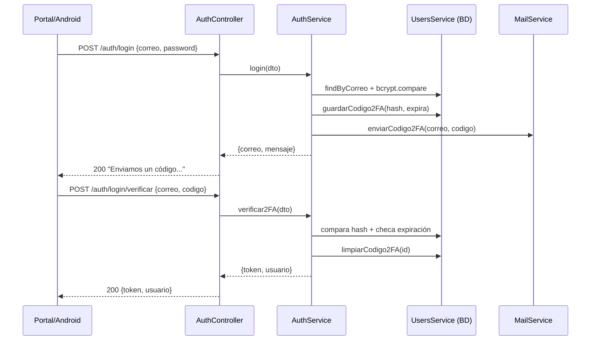

# `backend/src/auth/auth.service.ts`

**En una frase:** contiene toda la lógica real de autenticación: login en dos pasos (contraseña + código por correo), registro de aspirantes, y recuperación/restablecimiento de contraseña.

## Por qué existe

Un `Controller` en NestJS solo debería traducir HTTP a llamadas de negocio; toda la lógica (hashear contraseñas, generar códigos, decidir cuándo emitir un JWT) vive aquí para poder probarla sin necesidad de levantar peticiones HTTP (ver `auth.service.spec.ts`) y para que `AuthController` quede como una capa fina.

## Recorrido del código

### Login en dos pasos

```ts
async login(dto: LoginDto): Promise<Requiere2FAResponse> {
  const user = await this.users.findByCorreo(dto.correo);
  const hash = user?.passwordHash ?? DUMMY_HASH;
  const ok = await bcrypt.compare(dto.password, hash);
  if (!user || !ok) {
    throw new UnauthorizedException('Correo o contraseña incorrectos');
  }
  const codigo = randomInt(0, 1_000_000).toString().padStart(6, '0');
  const codigoHash = await bcrypt.hash(codigo, BCRYPT_ROUNDS);
  const expira = new Date(Date.now() + DOS_FA_VIGENCIA_MS);
  await this.users.guardarCodigo2FA(user.id, codigoHash, expira);
  await this.mail.enviarCodigo2FA(user.correo, codigo);
  return { correo: user.correo, mensaje: 'Enviamos un código de verificación a tu correo.' };
}
```
Puntos clave:
- `DUMMY_HASH = bcrypt.hashSync('iinicia-dummy-password', BCRYPT_ROUNDS)` se calcula una sola vez al cargar el módulo. Si el correo no existe, el código igual llama a `bcrypt.compare` contra este hash de relleno en vez de devolver el error inmediatamente. La alternativa simple ("si no existe el usuario, devuelve error ya") es más rápida de escribir, pero permite un ataque de *timing*: un atacante podría medir cuánto tarda la respuesta y así adivinar qué correos existen (comparar con bcrypt es lento a propósito; buscar y no encontrar es rápido). Usando siempre el mismo costo de cómputo, exista o no la cuenta, el tiempo de respuesta no delata nada.
- No se entrega el JWT en este paso: solo se genera un código de 6 dígitos, se guarda **hasheado** (nunca en texto plano, igual que una contraseña) junto con su expiración, y se envía por correo. El segundo factor se resuelve en `verificar2FA`.
- `DOS_FA_VIGENCIA_MS = 5 * 60 * 1000` (5 minutos): ventana corta a propósito, porque es un código numérico de solo 6 dígitos (1 millón de combinaciones), mucho más fácil de adivinar por fuerza bruta que un token largo aleatorio; por eso además `AuthController` limita este endpoint a 5 intentos por minuto con `@Throttle`.

### Verificación del segundo factor

```ts
async verificar2FA(dto: Verificar2FADto): Promise<AuthResponse> {
  const user = await this.users.findByCorreo(dto.correo);
  const vencido = !user?.twoFactorCodeExpira || user.twoFactorCodeExpira.getTime() < Date.now();
  const coincide =
    user?.twoFactorCodeHash && (await bcrypt.compare(dto.codigo, user.twoFactorCodeHash));
  if (!user || !coincide || vencido) {
    throw new UnauthorizedException('El código es inválido o ya venció');
  }
  await this.users.limpiarCodigo2FA(user.id);
  return this.buildResponse(user);
}
```
Verifica **dos** condiciones independientes (coincide el hash *y* no venció) antes de entregar el JWT, y borra el código inmediatamente después de usarlo para que no pueda reutilizarse ni quedar vigente innecesariamente.



### Registro de aspirantes

```ts
async registro(dto: RegistroDto): Promise<AuthResponse> {
  if (await this.users.findByCorreo(dto.correo)) {
    throw new BadRequestException('Ya existe una cuenta con ese correo');
  }
  ...
  try {
    user = await this.users.create({ ...rol: Rol.Aspirante, ... });
  } catch (error) {
    if ((error as { code?: string }).code === '23505') {
      throw new BadRequestException('Ya existe una cuenta con ese correo');
    }
    throw error;
  }
  return this.buildResponse(user);
}
```
- Nunca toca Moodle. El comentario del código cita directamente la regla de negocio (`docs/requerimientos.md §12`): "tener una cuenta no debe implicar acceso automático a los cursos". El acceso a Moodle solo lo concede después un administrador (ver `usuarios.controller.md`).
- El chequeo `findByCorreo` antes de `create` no es suficiente por sí solo para evitar correos duplicados: dos registros simultáneos con el mismo correo podrían pasar ambos esa verificación antes de que cualquiera termine de guardarse (condición de carrera). Por eso además se captura el código de error `23505` (`unique_violation` de PostgreSQL, que viene de la restricción `unique: true` en `User.correo`) y se traduce al mismo mensaje de negocio. La restricción única en la base de datos es la que realmente garantiza que nunca haya dos cuentas con el mismo correo; el `findByCorreo` previo solo evita una consulta fallida en el caso común.
- Qué valida `RegistroDto` (`auth/dto/registro.dto.ts`) al vuelo: nombre completo obligatorio (máx. 200 caracteres), correo válido (máx. 254), contraseña de 8 a 72 caracteres (72 es el límite real de bcrypt — más que eso se trunca silenciosamente), un `programaInteresId` obligatorio, aceptación obligatoria del aviso de privacidad (`@Equals(true)`, no basta con que sea booleano: tiene que ser `true`) y la preferencia opcional `deseaInformacionBecas`.

### Recuperación y restablecimiento de contraseña

```ts
async recuperar(correo: string): Promise<void> {
  const user = await this.users.findByCorreo(correo);
  if (!user) return;
  const tokenCrudo = randomBytes(32).toString('base64url');
  const tokenHash = await bcrypt.hash(tokenCrudo, BCRYPT_ROUNDS);
  const expira = new Date(Date.now() + 60 * 60 * 1000);
  await this.users.guardarTokenRecuperacion(user.id, tokenHash, expira);
  ...
}
```
Si el correo no existe, la función simplemente retorna sin error ni distinción visible: `AuthController.recuperar` siempre responde el mismo mensaje genérico ("Si el correo existe, se envió un enlace..."), exista o no la cuenta. Esto evita que alguien use este endpoint para averiguar qué correos están registrados en la plataforma (ver `docs/requerimientos.md` Sec. 16).

El token real nunca se guarda en texto plano, solo su hash — el mismo patrón que el código 2FA y las contraseñas: aunque alguien leyera la base de datos, no podría reconstruir el token ni la contraseña.

`restablecer` hace la verificación simétrica (hash + expiración) antes de reemplazar la contraseña, y siempre limpia el token al terminar para que no pueda reutilizarse.

### `buildResponse`

```ts
private async buildResponse(user: User): Promise<AuthResponse> {
  const token = await this.jwt.signAsync({ sub: user.id, rol: user.rol });
  return { token, usuario: { id: user.id, nombre: user.nombre, correo: user.correo, rol: user.rol } };
}
```
El JWT solo lleva `sub` (id del usuario) y `rol`. No lleva nombre ni correo: `JwtStrategy.validate` siempre vuelve a consultar la base de datos con ese `sub` para obtener los datos y el rol *actuales*, así un cambio de rol o una baja de cuenta tiene efecto inmediato sin esperar a que expire el token (ver `jwt.strategy.md`).

## Conexión con el resto del sistema

- Lo llama `AuthController` (HTTP).
- Depende de `UsersService` (persistencia de usuarios, hashes y tokens), `JwtService` de `@nestjs/jwt` (firma de tokens), `ConfigService` (lee `FRONTEND_URL` para construir el enlace de recuperación) y `MailService` (envío real/simulado de correos).
- Nunca importa `MoodleService` directamente: la vinculación a Moodle sucede después, desde `UsuariosController`, vía la función compartida `vincularYMatricularMoodle`.

## Cosas que no son obvias a primera vista

- El hash de relleno (`DUMMY_HASH`) y el patrón "siempre responde igual" en `recuperar` son ambos mitigaciones de *timing attacks* / enumeración de usuarios — un atacante no puede deducir si un correo existe midiendo tiempos de respuesta ni leyendo el mensaje de error.
- El 2FA no usa TOTP (como Google Authenticator) sino un código enviado por correo, guardado hasheado con expiración corta. Es una decisión deliberada documentada en la memoria del proyecto (se abandonó "login con Google" por requerir 2FA de terceros, y se migró a este esquema propio).
- `BCRYPT_ROUNDS = 10` se aplica tanto a contraseñas como a los tokens/códigos de un solo uso (recuperación, 2FA): aunque esos valores no son contraseñas elegidas por el usuario, se tratan con el mismo nivel de protección por si la base de datos se filtra.
