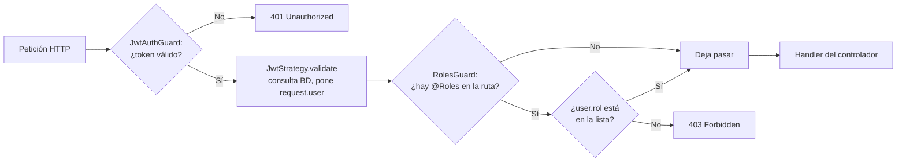

# `backend/src/auth/roles.guard.ts`

**En una frase:** guard que revisa si el rol del usuario autenticado está en la lista de roles permitidos para esa ruta (declarada con `@Roles(...)`); si no, responde 403.

## Por qué existe

El requisito "los permisos se validan en el backend, no solo en la interfaz" (ver `CLAUDE.md`) significa que el frontend puede ocultar un botón, pero eso no es suficiente: alguien podría llamar a la API directamente con herramientas como curl o Postman. `RolesGuard` es la validación real e ineludible de "¿tiene este rol permiso para esta acción?", sin importar qué muestra o esconde la interfaz.

## Recorrido del código

```ts
canActivate(context: ExecutionContext): boolean {
  const requiredRoles = this.reflector.getAllAndOverride<string[] | undefined>(ROLES_KEY, [
    context.getHandler(),
    context.getClass(),
  ]);
  if (!requiredRoles || requiredRoles.length === 0) return true;

  const { user } = context.switchToHttp().getRequest<Request & { user?: UsuarioAutenticado }>();
  if (!user || !requiredRoles.includes(user.rol)) {
    throw new ForbiddenException('No tienes permiso para esta acción');
  }
  return true;
}
```
- `reflector.getAllAndOverride(ROLES_KEY, [handler, class])` busca metadata de `@Roles(...)` primero en el método específico de la ruta y, si no encuentra, en el controlador completo. Esto permite declarar `@Roles(...)` una sola vez a nivel de clase (como hace `AspiranteController`, con `@Roles(Rol.Aspirante)` en el controlador entero) o por método individual (como `MateriasController`, con roles distintos en cada handler si hiciera falta).
- Si una ruta **no** tiene ningún `@Roles(...)` declarado, el guard deja pasar a cualquier usuario autenticado (`return true`), sin restringir por rol. Esto es intencional: no todas las rutas protegidas por sesión necesitan restricción de rol (por ejemplo, `/estudiante/cursos` solo necesita "estar logueado", cualquier rol puede verla).
- Lee `request.user`, que debe haber sido puesto ahí por `JwtAuthGuard` (de ahí que el comentario del código exija "debe usarse junto a `JwtAuthGuard`, después de él").



## Conexión con el resto del sistema

- Se aplica con `@UseGuards(JwtAuthGuard, RolesGuard)` (el orden importa: autenticación primero).
- Lee la metadata que pone `@Roles(...)` (`roles.decorator.ts`).
- Lo usan `UsuariosController`, `DocumentosController`, `MateriasController`, `ProgramasController` (solo en las rutas de escritura) y `AspiranteController`.
- Trabaja sobre el `UsuarioAutenticado` que definió `JwtStrategy`.

## Cosas que no son obvias a primera vista

- Sin `@Roles(...)`, la ruta queda abierta a cualquier rol autenticado — no es un "denegar por defecto", es un "permitir por defecto si no se especifica". Por eso cada ruta que debe restringirse necesita su propio `@Roles(...)` explícito; olvidarlo en una ruta nueva es exactamente el tipo de hallazgo que buscó la auditoría de seguridad del proyecto.
- El guard no distingue "rol insuficiente" de "sin sesión": si `user` no existe (caso raro, porque normalmente `JwtAuthGuard` ya habría bloqueado antes) también lanza 403, no 401.
- `getAllAndOverride` significa que un `@Roles(...)` en un método individual **sobreescribe** por completo al de la clase, no se suman las listas.
