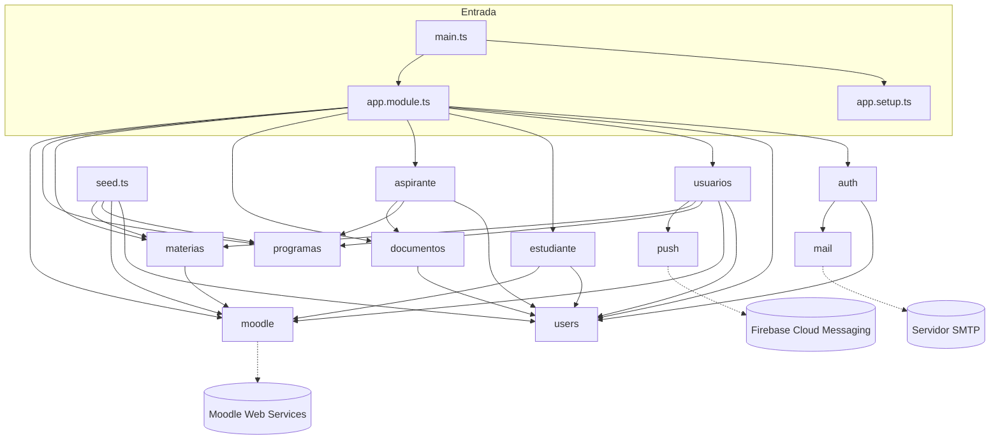

# Código explicado — Backend de IINICIA

Documentación "programación literaria" del backend (NestJS + TypeScript + PostgreSQL + JWT): un archivo `.md` por cada archivo fuente con lógica real, en español, pensado para alguien sin conocimiento previo del sistema. Cada ruta de abajo refleja la ruta real del archivo fuente dentro de `backend/src/`.

## Arranque de la aplicación

- [`main.md`](./main.md) — punto de entrada: crea la app NestJS y la pone a escuchar.
- [`app.setup.md`](./app.setup.md) — configuración compartida de seguridad (helmet, CORS, validación, filtro de errores) que usan tanto `main.ts` como las pruebas e2e.
- [`app.module.md`](./app.module.md) — módulo raíz: conecta todos los módulos, PostgreSQL y el límite global de peticiones.
- [`seed.md`](./seed.md) — script manual que deja la base con programas, materias y usuarios de prueba (uno por rol) conocidos y repetibles.

## Autenticación y autorización (`auth/`)

- [`auth/auth.service.md`](./auth/auth.service.md) — lógica real de login en dos pasos (2FA por correo), registro, recuperación y restablecimiento de contraseña.
- [`auth/auth.controller.md`](./auth/auth.controller.md) — rutas HTTP de `/auth/*`, con límites estrictos de peticiones para evitar fuerza bruta.
- [`auth/jwt.strategy.md`](./auth/jwt.strategy.md) — cómo se valida el JWT de cada petición y se resuelve el usuario actual (siempre contra la base de datos, nunca confiando ciegamente en el token).
- [`auth/jwt-auth.guard.md`](./auth/jwt-auth.guard.md) — guard que exige sesión válida (401 si no la hay).
- [`auth/roles.guard.md`](./auth/roles.guard.md) — guard que exige que el rol del usuario esté autorizado para la ruta (403 si no).
- [`auth/roles.decorator.md`](./auth/roles.decorator.md) — decorador `@Roles(...)` que declara qué roles puede usar una ruta.
- [`auth/usuario-actual.decorator.md`](./auth/usuario-actual.decorator.md) — decorador `@UsuarioActual()` para leer el usuario autenticado en un controlador.
- [`auth/ambito-coordinador.md`](./auth/ambito-coordinador.md) — función compartida que limita a un coordinador a su programa asignado.

## Usuarios, estudiante y aspirante

- [`users/users.service.md`](./users/users.service.md) — acceso a la tabla `users`: búsqueda, listado y actualizaciones (rol, contraseña, tokens).
- [`users/user.entity.md`](./users/user.entity.md) — modelo de la tabla `users`: identidad, credenciales, rol, vínculo con Moodle, 2FA/recuperación.
- [`usuarios/usuarios.controller.md`](./usuarios/usuarios.controller.md) — panel administrativo: listar, admitir (cambiar rol + vincular Moodle), matricular manualmente, ver "mis estudiantes" (profesor) y notificaciones push controladas.
- [`estudiante/estudiante.controller.md`](./estudiante/estudiante.controller.md) — autoservicio del estudiante: cursos y actividades reales (Moodle), registro de token push, SSO al campus.
- [`aspirante/aspirante.controller.md`](./aspirante/aspirante.controller.md) — autoservicio del aspirante: estado de su solicitud y subida de documentos de admisión.

## Documentos de admisión (`documentos/`)

- [`documentos/documentos.service.md`](./documentos/documentos.service.md) — acceso a la tabla `documentos` y la función que nunca expone la ruta real en disco.
- [`documentos/documentos.controller.md`](./documentos/documentos.controller.md) — revisión administrativa: listar por usuario (con ámbito de coordinador), aprobar/rechazar, servir el archivo.
- [`documentos/storage.md`](./documentos/storage.md) — configuración de Multer: carpeta, nombre aleatorio, tipos y tamaño permitidos.
- [`documentos/documento.entity.md`](./documentos/documento.entity.md) — modelo de la tabla `documentos`.

## Materias y seriación (`materias/`)

- [`materias/materias.service.md`](./materias/materias.service.md) — CRUD de materias y la verificación real de prerequisitos antes de una matrícula.
- [`materias/materias.controller.md`](./materias/materias.controller.md) — rutas CRUD, solo para roles administrativos.
- [`materias/materia.entity.md`](./materias/materia.entity.md) — modelo de la tabla `materias`: curso de Moodle + carrera + prerequisitos.

## Programas (`programas/`)

- [`programas/programas.service.md`](./programas/programas.service.md) — acceso al catálogo de oferta académica y resolución del curso de Moodle de un programa.
- [`programas/programas.controller.md`](./programas/programas.controller.md) — lectura pública del catálogo, escritura solo administrativa.
- [`programas/programa.entity.md`](./programas/programa.entity.md) — modelo de la tabla `programas`.

## Integración con Moodle (`moodle/`)

- [`moodle/moodle.service.md`](./moodle/moodle.service.md) — único cliente de Moodle Web Services: usuarios, matrícula, progreso, actividades, SSO; aquí vive el token de Moodle y nada más.
- [`moodle/moodle-onboarding.md`](./moodle/moodle-onboarding.md) — función compartida que vincula y matricula a un usuario sin nunca lanzar un error que interrumpa el flujo que la llamó.

## Correo y notificaciones push

- [`mail/mail.service.md`](./mail/mail.service.md) — envío (o simulación en log) de correos de recuperación y 2FA.
- [`push/push.service.md`](./push/push.service.md) — envío (o simulación en log) de notificaciones push a Android vía Firebase, siempre como "data message".

## Transversal (`common/`)

- [`common/all-exceptions.filter.md`](./common/all-exceptions.filter.md) — filtro global: cualquier error, de cualquier origen, siempre responde `{ message: string }`.

## Qué se dejó fuera, y por qué

- **`*.module.ts`** (`auth.module.ts`, `users.module.ts`, `moodle.module.ts`, etc.): son boilerplate de NestJS — solo declaran qué controlador, servicio y entidad pertenecen a cada módulo, sin lógica propia que explicar. Se mencionan de paso dentro del documento del archivo que usan cuando es relevante.
- **Carpetas `dto/`** (`registro.dto.ts`, `login.dto.ts`, `crear-materia.dto.ts`, etc.): son clases de validación con decoradores de `class-validator`. Se explican al vuelo, en el documento del servicio/controlador que las usa, en vez de tener un archivo propio cada una.
- **`*.spec.ts`**: son las pruebas automatizadas de cada módulo, no código de producción.
- **`users/rol.enum.ts`**: un enum de una sola línea por rol (`superadmin`, `admin_academico`, `coordinador`, `profesor`, `estudiante`, `aspirante`); se referencia en varios documentos (por ejemplo `users/user.entity.md` y `auth/roles.decorator.md`) sin necesitar un archivo propio.

## Mapa de módulos del backend

El token de Moodle, las credenciales SMTP y la cuenta de servicio de Firebase viven únicamente dentro de `moodle.service.ts`, `mail.service.ts` y `push.service.ts` respectivamente, leídos de variables de entorno: ningún otro módulo (y mucho menos el frontend o Android) los conoce o los recibe.
