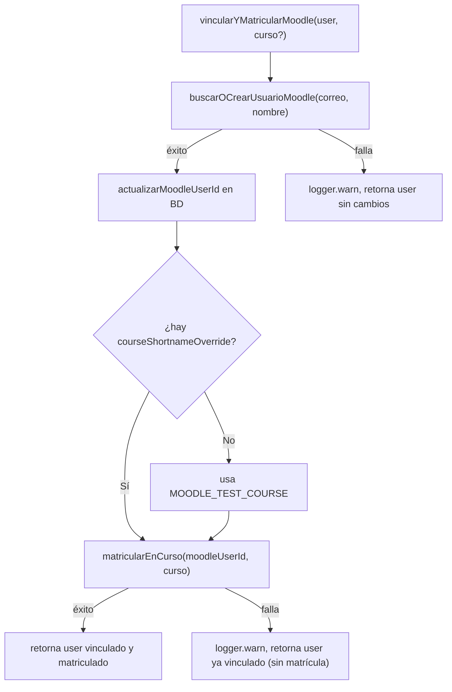

# `backend/src/moodle/moodle-onboarding.ts`

**En una frase:** función compartida que vincula a un usuario con su cuenta Moodle y lo matricula en un curso, sin lanzar nunca un error que interrumpa el flujo que la llamó.

## Por qué existe

Vincular y matricular a un usuario en Moodle son dos pasos que se repiten en más de un lugar del sistema: cuando un aspirante es admitido como estudiante (`UsuariosController.actualizarRol`) y cuando un administrador lo matricula manualmente en un curso específico (`UsuariosController.asignarCurso`), además del script de siembra (`seed.ts`). Extraer esta lógica a una sola función evita que cada punto de entrada reimplemente el mismo manejo de errores (y, potencialmente, lo haga de forma distinta).

## Recorrido del código

```ts
export async function vincularYMatricularMoodle(
  { users, moodle, config, logger }: OnboardingDeps,
  user: User,
  courseShortnameOverride?: string | null,
): Promise<User> {
  try {
    const moodleUserId = await moodle.buscarOCrearUsuarioMoodle(user.correo, user.nombre);
    await users.actualizarMoodleUserId(user.id, moodleUserId);
    user.moodleUserId = moodleUserId;

    const curso = courseShortnameOverride ?? config.get<string>('MOODLE_TEST_COURSE', 'IINICIA101');
    try {
      await moodle.matricularEnCurso(moodleUserId, curso);
    } catch (error) {
      logger.warn(`No se pudo matricular al usuario ${user.id} en el curso ${curso}: ${String(error)}`);
    }
    return user;
  } catch (error) {
    logger.warn(`No se pudo vincular a Moodle el usuario ${user.id}: ${String(error)}`);
    return user;
  }
}
```
- Hay dos bloques `try/catch` anidados, no uno solo, y es a propósito: vincular la cuenta (crear/buscar el usuario en Moodle) y matricularlo en un curso son dos operaciones independientes que pueden fallar por separado. Si la vinculación tiene éxito pero la matrícula falla (por ejemplo, porque el curso todavía no existe en Moodle), el usuario igual queda con su `moodleUserId` guardado — no se pierde ese progreso solo porque el segundo paso falló.
- **Nunca lanza una excepción hacia quien la llamó.** Cualquier error (de red, de Moodle, de lo que sea) termina en un `logger.warn(...)` y la función retorna igual el `user` (modificado si se logró vincular, sin cambios si no). Esto es deliberado: si Moodle está caído en el momento en que un administrador promueve a un aspirante a estudiante, esa promoción de rol **sí** debe completarse en IINICIA (el usuario ya es "estudiante" en el sistema), aunque la vinculación a Moodle quede pendiente para reintentarse después. Si esta función lanzara un error, la promoción de rol completa fallaría por un problema externo que no debería bloquear una decisión administrativa ya tomada.
- `courseShortnameOverride ?? config.get('MOODLE_TEST_COURSE', 'IINICIA101')`: si no se especifica un curso (porque el programa de interés del usuario todavía no tiene uno asignado, ver `programas.service.ts`), se usa un curso de respaldo configurable, con `IINICIA101` como valor por defecto si ni siquiera esa variable de entorno está definida.



## Conexión con el resto del sistema

- La llaman `UsuariosController.actualizarRol`, `UsuariosController.asignarCurso` y `seed.ts`.
- Depende de `UsersService.actualizarMoodleUserId`, `MoodleService.buscarOCrearUsuarioMoodle` y `MoodleService.matricularEnCurso`, y de `ConfigService` para `MOODLE_TEST_COURSE`.
- Recibe sus dependencias como parámetros (`OnboardingDeps`) en vez de ser una clase inyectable de Nest: así puede llamarse igual desde un controlador (que sí tiene inyección de dependencias) y desde `seed.ts` (un script fuera del ciclo de vida normal de peticiones HTTP), ensamblando el objeto de dependencias a mano en cada caso.

## Cosas que no son obvias a primera vista

- Que esta función nunca lance es la pieza clave de la regla "integración con Moodle idempotente" en la práctica: no solo significa "no duplica", también significa "nunca bloquea una operación de IINICIA solo porque Moodle no respondió". El usuario queda en un estado parcial recuperable (vinculado sin matricular, o ni siquiera vinculado), nunca en un estado roto a mitad de camino que tronara toda la petición HTTP.
- `OnboardingLogger` es una interfaz mínima (`{ warn(message: string): void }`), no el tipo completo `Logger` de Nest — así la función puede recibir tanto un `Logger` real (de un controlador) como cualquier otro objeto compatible en pruebas.
