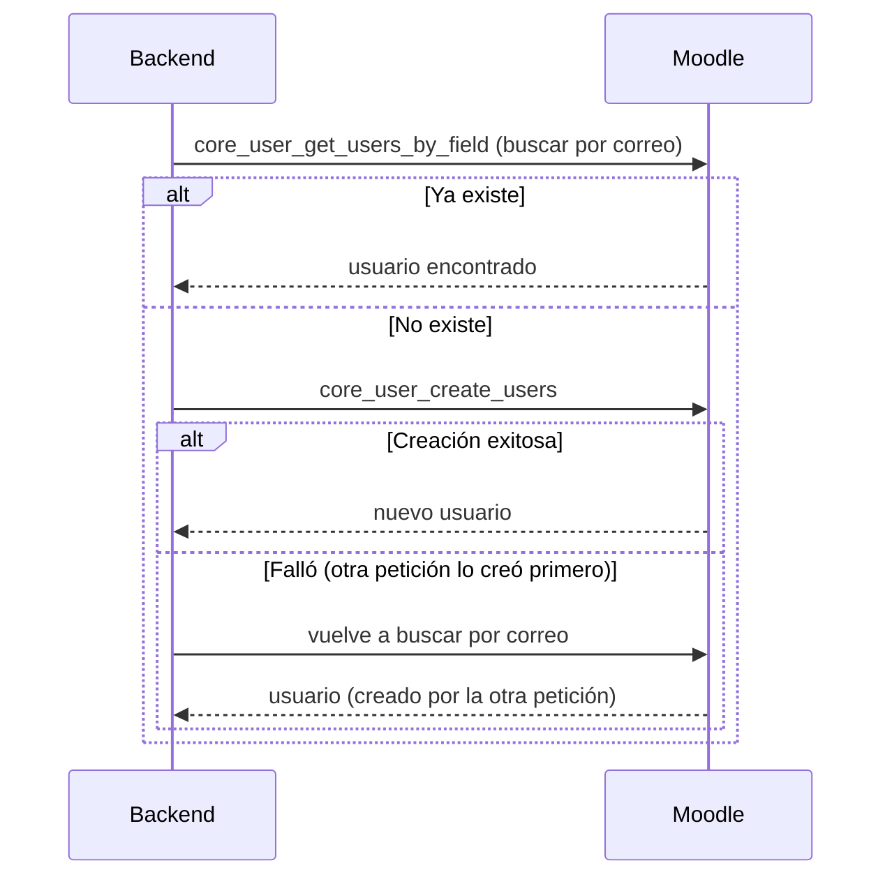

# `backend/src/moodle/moodle.service.ts`

**En una frase:** el único cliente HTTP que habla con Moodle Web Services (REST): crea/busca usuarios, matricula en cursos, lee progreso, actividades próximas y genera accesos de un solo uso (SSO) — siempre guardando el token de Moodle solo en memoria del backend.

## Por qué existe

`CLAUDE.md` exige: "Ningún token de Moodle en React ni en Android; solo en el backend (.env)". Este servicio es, literalmente, la materialización de esa regla: todo lo que el portal o Android necesitan saber de Moodle pasa por aquí, y esta es la única clase que lee `MOODLE_TOKEN` del entorno. Además traduce las particularidades de la API de Moodle (que devuelve errores con HTTP 200, que escapa el HTML de los textos, que puede necesitar una cabecera `Host` especial en Docker) en una interfaz limpia para el resto del backend.

## Recorrido del código

### Decodificar el HTML que escapa Moodle

```ts
function decodificarHtml(texto: string): string {
  return texto
    .replace(/&amp;/g, '&')
    .replace(/&lt;/g, '<')
    .replace(/&gt;/g, '>')
    .replace(/&quot;/g, '"')
    .replace(/&#0?39;/g, "'");
}
```
Moodle devuelve los campos de texto (nombres de cursos, títulos de actividades) ya "escapados para HTML" — por ejemplo, `Cloud & Kubernetes` llega como `Cloud &amp; Kubernetes` — porque asume que se van a insertar directo en una página web. El portal y Android muestran esos textos como texto plano, no como HTML, así que sin esta función el usuario vería literalmente el símbolo `&amp;` en vez de `&`. Se aplica a cada campo de texto que viene de Moodle: nombres de curso, nombres de usuario, títulos de actividad.

### Crear o vincular un usuario, de forma idempotente

```ts
async buscarOCrearUsuarioMoodle(correo: string, nombreCompleto: string): Promise<number> {
  const email = correo.trim().toLowerCase();
  if (!email) { throw new BadRequestException('El correo es obligatorio'); }
  const existente = await this.buscarPorCorreo(email);
  if (existente !== null) return existente;
  try {
    return await this.crearUsuario(email, nombreCompleto);
  } catch (error) {
    const creadoMientras = await this.buscarPorCorreo(email);
    if (creadoMientras !== null) return creadoMientras;
    throw error;
  }
}
```
Este método implementa literalmente la "integración idempotente" que exige `CLAUDE.md`: llamarlo varias veces con el mismo correo nunca crea usuarios duplicados en Moodle. El `catch` cubre una condición de carrera real: si dos peticiones concurrentes intentan vincular el mismo correo, ambas podrían pasar la búsqueda inicial sin encontrar nada; cuando la segunda falla al crear (porque la primera ya lo creó), en vez de propagar el error se vuelve a buscar — si ya existe, se devuelve ese id en vez de fallar.



### Matrícula también idempotente

```ts
async matricularEnCurso(moodleUserId: number, courseShortname: string, roleId?: string): Promise<void> {
  const courseId = await this.buscarCursoPorShortname(courseShortname);
  if (courseId === null) {
    throw new BadGatewayException(`No existe el curso "${courseShortname}" en Moodle`);
  }
  const rolAsignado = roleId ?? this.config.get<string>('MOODLE_ROLEID_STUDENT', '5');
  await this.llamar<null>('enrol_manual_enrol_users', { ... });
}
```
El comentario del código aclara que Moodle mismo "no duplica ni falla si ya estaba matriculado" — la idempotencia aquí no la implementa IINICIA, la garantiza la propia API de Moodle, y por eso es seguro llamar a este método repetidamente (lo hace `seed.ts` en cada corrida para el profesor de prueba).

### Progreso y "aprobado"

```ts
async obtenerCursosAprobados(moodleUserId: number): Promise<Set<string>> {
  const cursos = await this.obtenerCursosDeUsuario(moodleUserId);
  return new Set(cursos.filter((c) => c.progress === 100).map((c) => c.shortname));
}
```
El criterio de "aprobado" para la seriación de materias es, literalmente, `progress === 100` (finalización del curso activada en Moodle), nunca una calificación. El comentario del código lo señala con honestidad: "Moodle no distingue 'reprobada' de 'en curso' sin una calificación configurada, así que ambas bloquean el avance por igual" — es una limitación conocida, no un error.

### SSO de un solo uso

```ts
async solicitarUrlAutologin(correo: string, cursoId?: number, actividadUrl?: string): Promise<string> {
  const email = correo.trim().toLowerCase();
  const { loginurl } = await this.llamar<{ loginurl: string }>('auth_userkey_request_login_url', { 'user[email]': email });
  if (!loginurl) { throw new BadGatewayException('Moodle no devolvió una URL de acceso'); }
  if (!cursoId && !actividadUrl) return loginurl;
  const origen = new URL(loginurl).origin;
  const urlDestino = actividadUrl ? this.validarMismoOrigen(actividadUrl, origen) : `${origen}/course/view.php?id=${cursoId}`;
  const separador = loginurl.includes('?') ? '&' : '?';
  return `${loginurl}${separador}wantsurl=${encodeURIComponent(urlDestino)}`;
}
```
Usa el plugin `auth_userkey` (instalado en `infrastructure/moodle-custom/auth/userkey`, sin tocar el core de Moodle — ver `CLAUDE.md`) para generar una URL que entra ya autenticado, válida una sola vez y por pocos segundos. El comentario explica por qué **no** se construye la URL destino usando `MOODLE_URL` del `.env`: en Docker esa variable apunta al nombre interno del contenedor (`http://moodle`), que el navegador del usuario final nunca podría resolver. En cambio, se reusa el `origin` de la propia `loginurl` que Moodle ya devolvió armada con su `wwwroot` público real.

```ts
private validarMismoOrigen(url: string, origenEsperado: string): string {
  let origenReal: string;
  try { origenReal = new URL(url).origin; } catch { throw new BadRequestException('URL de actividad inválida'); }
  if (origenReal !== origenEsperado) { throw new BadRequestException('La actividad no pertenece a esta instancia de Moodle'); }
  return url;
}
```
`actividadUrl` llega hasta aquí a través de un query param que controla el cliente (aunque en el flujo normal venga de datos que el propio Moodle reportó antes, vía `obtenerActividadesProximas`). Como de todos modos pasa por un parámetro que el cliente puede manipular, se revalida que el origen coincida con el de Moodle antes de usarla como destino del SSO — evita que alguien use este endpoint para redirigir el `wantsurl` del autologin hacia un sitio arbitrario.

### Por qué existe `MOODLE_HOST_HEADER`

```ts
private async postForm(url: string, body: URLSearchParams): Promise<...> {
  const hostHeader = this.config.get<string>('MOODLE_HOST_HEADER');
  if (!hostHeader) {
    const response = await fetch(url, { ... });
    return { status: response.status, json: () => response.json() };
  }
  // ... usa node:http/https directamente, forzando la cabecera Host
}
```
El comentario del código explica un problema real de infraestructura: Moodle redirige (303) cualquier petición cuyo `Host` no coincida con su `$CFG->wwwroot` configurado — incluso en su propio endpoint de webservices. En Docker, el backend llega a Moodle por el nombre de servicio interno (`http://moodle`), distinto del `wwwroot` público (`localhost:8080`), y la especificación de `fetch()` **prohíbe** forzar manualmente la cabecera `Host`. Por eso, cuando se configura `MOODLE_HOST_HEADER` (solo necesario en ese escenario Docker), el código cae a usar `node:http`/`node:https` directamente, que sí permite forzar esa cabecera.

### Manejo uniforme de errores

```ts
const err = data as MoodleErrorBody | null;
if (err && !Array.isArray(data) && typeof err === 'object' && err.exception) {
  this.logger.error(`Moodle error en ${wsfunction}: ${err.errorcode} - ${err.message}`);
  throw new BadGatewayException('Moodle rechazó la operación');
}
```
Moodle reporta sus propios errores con HTTP 200 (no con un código de error HTTP), devolviendo un cuerpo JSON con `{ exception, errorcode, message }`. El método `llamar` detecta ese patrón explícitamente y lo convierte en una `BadGatewayException` (502: el backend sí respondió, pero el servicio externo falló), para que el resto del sistema no tenga que conocer esta peculiaridad de Moodle.

## Conexión con el resto del sistema

- Es la única clase que lee `MOODLE_URL`, `MOODLE_TOKEN`, `MOODLE_HOST_HEADER`, `MOODLE_ROLEID_STUDENT`, `MOODLE_ROLEID_TEACHER` del entorno.
- Lo usan `moodle-onboarding.ts`, `UsuariosController`, `EstudianteController`, `MateriasService` y `seed.ts`.
- Habla con Moodle vía `webservice/rest/server.php`, y con el plugin a medida `auth_userkey` (instalado en `infrastructure/`, nunca modificando el core de Moodle).

## Cosas que no son obvias a primera vista

- El token de Moodle (`MOODLE_TOKEN`) nunca se registra en logs ni se devuelve en ninguna respuesta: los métodos de logging solo imprimen el nombre de la función de Moodle (`wsfunction`) y el código/mensaje de error, nunca el cuerpo completo de la petición.
- La contraseña que se genera al crear un usuario en Moodle (`generarPassword`) nunca la usa nadie de verdad: el acceso real siempre es por el SSO de `auth_userkey`, así que esa contraseña solo existe para satisfacer la política de contraseñas de Moodle en el momento de la creación.
- `obtenerEstudiantesDeCurso` filtra explícitamente por el rol `student` (`r.shortname === 'student'`): un profesor nunca vería, por accidente, a otro profesor o a un administrador listado como "su estudiante".
