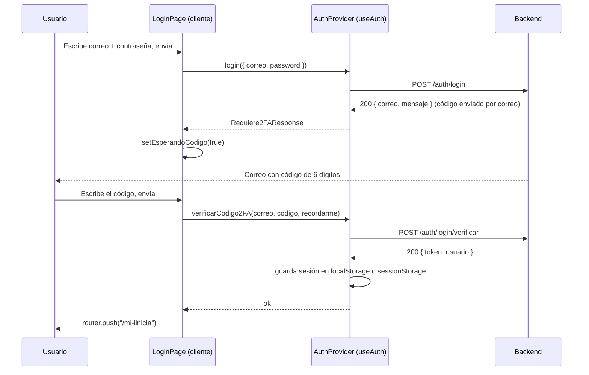

# `frontend/app/login/page.tsx`

**En una frase:** pantalla de inicio de sesión en dos pasos: primero correo y contraseña, luego un código de 6 dígitos (segundo factor) que llega al correo.

## Por qué existe
IINICIA migró de "login con Google" a autenticación de dos factores (2FA) propia (ver `migracion_2fa_login` en la memoria del proyecto). Esta página es el punto de entrada a "Mi Campus" para cualquier rol (estudiante, profesor, admin, etc.). Nunca entrega el token de sesión con solo correo+contraseña: eso evita que una contraseña filtrada sea suficiente para entrar a la cuenta de alguien.

## Recorrido del código

### Los dos pasos como un solo estado
```tsx
const [esperandoCodigo, setEsperandoCodigo] = useState(false);
const [codigo, setCodigo] = useState("");
const [codigoError, setCodigoError] = useState<string | null>(null);
```
`esperandoCodigo` decide qué formulario se muestra: `false` = pantalla de correo/contraseña, `true` = pantalla del código de verificación. No son dos páginas distintas de Next.js a propósito: comparten el mismo `correo` ya capturado, y volver al paso 1 (botón "Volver") solo necesita resetear estas tres variables, sin perder el contexto de la página.

```tsx
async function handleSubmit(event: FormEvent<HTMLFormElement>) {
  event.preventDefault();
  setSubmitError(null);
  if (!validate()) return;
  setSubmitting(true);
  try {
    await login({ correo, password });
    setEsperandoCodigo(true);
  } catch (error) {
    setSubmitError(
      error instanceof ApiError ? error.message : "No pudimos iniciar tu sesión. Verifica tus datos e intenta de nuevo.",
    );
  } finally {
    setSubmitting(false);
  }
}
```
`login()` (de `useAuth()`) manda correo+contraseña al backend. Si son correctos, el backend ya disparó el envío del código por correo y esta función simplemente pasa a `esperandoCodigo = true`: la función `login` **no** abre sesión, solo valida el primer factor.

```tsx
async function handleSubmitCodigo(event: FormEvent<HTMLFormElement>) {
  event.preventDefault();
  setCodigoError(null);
  setSubmitting(true);
  try {
    await verificarCodigo2FA(correo, codigo, recordarme);
    router.push("/mi-iinicia");
  } catch (error) {
    setCodigoError(error instanceof ApiError ? error.message : "No pudimos verificar el código. Intenta de nuevo.");
  } finally {
    setSubmitting(false);
  }
}
```
Recién aquí, con el código correcto, `verificarCodigo2FA` guarda la sesión real (token + usuario) y se navega a `/mi-iinicia`. El parámetro `recordarme` decide si la sesión se guarda en `localStorage` (sobrevive a cerrar el navegador) o en `sessionStorage` (se borra al cerrar la pestaña); ver `frontend/lib/auth-context.tsx`.

### Por qué los errores de red y de credenciales se muestran distinto
```tsx
error instanceof ApiError ? error.message : "No pudimos iniciar tu sesión. Verifica tus datos e intenta de nuevo."
```
Si el backend respondió (aunque sea con un error, como "contraseña incorrecta"), `ApiError` trae el mensaje real del backend y se muestra tal cual. Si lo que falló fue la conexión misma (backend caído, sin internet), se usa un mensaje genérico en español en vez de mostrar un error técnico de `fetch` al usuario.

### Validación en cliente, nunca como sustituto del backend
```tsx
function validate(): boolean {
  const nextErrors: { correo?: string; password?: string } = {};
  if (!/^\S+@\S+\.\S+$/.test(correo)) nextErrors.correo = "Ingresa un correo electrónico válido.";
  if (!password) nextErrors.password = "Ingresa tu contraseña.";
  setErrors(nextErrors);
  return Object.keys(nextErrors).length === 0;
}
```
Esta validación es solo para dar feedback inmediato (no gastar una llamada al backend por un correo vacío). La validación real de credenciales (¿existe esa cuenta?, ¿coincide la contraseña?) ocurre en el backend; este código nunca decide por sí solo si alguien puede entrar.

## Diagrama: flujo completo de login con 2FA



## Conexión con el resto del sistema
- Usa `useAuth()` de `frontend/lib/auth-context.tsx`, específicamente `login` y `verificarCodigo2FA`.
- Esas funciones llaman a `POST /auth/login` y `POST /auth/login/verificar` en el backend (ver `frontend/lib/api.ts`).
- Usa `Input`, `Button` y `Reveal` de `frontend/components/ui/`.
- Al terminar con éxito, navega a `/mi-iinicia` (`frontend/app/mi-iinicia/page.tsx`).
- Enlaza a `/recuperar` (¿olvidaste tu contraseña?) y `/registro` (¿aún no tienes cuenta?).

## Cosas que no son obvias a primera vista
- El token de Moodle **nunca** pasa por esta pantalla ni por el frontend: solo existe en el backend (regla del proyecto). Lo que esta página recibe es un JWT propio de IINICIA.
- "Recordarme" no afecta la seguridad del segundo factor, solo dónde se guarda la sesión una vez verificada (ver `frontend/lib/auth-context.tsx` para el detalle de `localStorage` vs `sessionStorage`).
- Si el usuario cierra la pestaña entre el paso 1 y el paso 2, pierde el progreso (el componente se desmonta y `esperandoCodigo` vuelve a `false`): tiene que pedir login de nuevo. Es una limitación conocida, no un bug.
