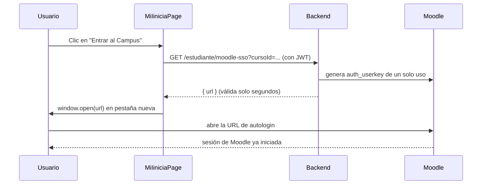

# `frontend/app/mi-iinicia/page.tsx`

**En una frase:** el panel "Mi Campus" una vez logueado: muestra cosas distintas según el rol (estudiante, profesor, aspirante, admin/coordinador) y es la puerta de entrada real a Moodle vía SSO.

## Por qué existe
Es la pantalla principal detrás del login: cada uno de los 6 roles de IINICIA (`superadmin`, `admin_academico`, `coordinador`, `profesor`, `estudiante`, `aspirante`) necesita ver información distinta aquí, y la página decide qué mostrar según `sesion.usuario.rol` en vez de tener una URL separada por rol. Es, con mucho, el archivo más complejo del frontend porque reúne todos los flujos reales contra el backend y Moodle: cursos, actividades, documentos de admisión, notificaciones y el acceso de un clic al campus virtual.

## Recorrido del código

### Protección de ruta: si no hay sesión, fuera
```tsx
useEffect(() => {
  if (!cargando && !sesion) {
    router.replace("/login");
  }
}, [cargando, sesion, router]);
```
Mientras `cargando` es `true` (el `AuthProvider` todavía está leyendo `localStorage`/`sessionStorage`), no se decide nada. En cuanto termina de cargar, si no hay `sesion`, se manda al usuario a `/login`. Esto es solo una conveniencia de interfaz: la verdadera protección de los datos vive en el backend, que rechaza cualquier llamada sin un JWT válido (regla del proyecto: "los permisos se validan en el backend, no solo en la interfaz").

### Qué ve cada rol
```tsx
const ROLES_CON_CURSOS: Rol[] = ["estudiante", "profesor"];
const ROLES_CON_RESUMEN: Rol[] = ["superadmin", "admin_academico", "coordinador"];
```
Estas listas deciden qué bloques de la página se renderizan: estudiante y profesor ven "Mis cursos" (de Moodle); superadmin/admin_academico/coordinador ven el resumen institucional (`DashboardResumen`); aspirante ve su seguimiento de solicitud (`DashboardAspirante`); profesor además ve `MisEstudiantesProfesor` al final.

### El SSO hacia Moodle: por qué la URL se pide justo antes de usarla
```tsx
/**
 * SSO vía auth_userkey (backend/src/moodle/moodle.service.ts): la url de
 * autologin expira en segundos y sirve una sola vez, así que se pide justo
 * antes de navegar, nunca se guarda ni se reutiliza.
 */
async function entrarAlCampus(cursoId: number) {
  if (!sesion) return;
  setErrorCampus(null);
  setEntrandoACursoId(cursoId);
  try {
    const url = await obtenerUrlCampus(sesion.token, cursoId);
    window.open(url, "_blank", "noopener,noreferrer");
  } catch (error) {
    if (manejarNoAutorizado(error)) return;
    setErrorCampus(error instanceof ApiError ? error.message : "No se pudo generar el acceso a Moodle. Intenta más tarde.");
  } finally {
    setEntrandoACursoId(null);
  }
}
```
Cuando el usuario hace clic en "Entrar al Campus", la página pide al backend (con su JWT, nunca con un token de Moodle propio porque el frontend nunca tiene uno) una URL especial de autologin de Moodle. Esa URL caduca en segundos y solo sirve una vez, así que **no tiene sentido pedirla por adelantado**: se pide justo en el clic y se abre de inmediato en una pestaña nueva. Guardarla en estado o en caché sería inútil (ya habría expirado) y además innecesario, porque nunca se reutiliza.

### Sesión vencida: un 401 no es un error cualquiera
```tsx
/** El token JWT expira a la hora (backend/src/auth/auth.module.ts); si una
 * llamada regresa 401 no es un error real, es que la sesión venció. */
function manejarNoAutorizado(error: unknown): boolean {
  if (error instanceof ApiError && error.status === 401) {
    logout();
    router.replace("/login");
    return true;
  }
  return false;
}
```
Cada llamada al backend en esta página (cursos, actividades, resumen, solicitud, documentos, estudiantes) pasa su error por esta función antes de mostrar un mensaje genérico. Si el backend responde 401 (token expirado o inválido), no se trata como un fallo de red: se cierra la sesión local y se redirige a `/login`, porque seguir mostrando datos viejos de una sesión muerta sería confuso.

### Patrón repetido: cargar datos reales con cancelación
```tsx
useEffect(() => {
  if (!sesion || !ROLES_CON_CURSOS.includes(sesion.usuario.rol)) return;
  let cancelado = false;

  obtenerMisCursos(sesion.token)
    .then((data) => { if (!cancelado) setCursos(data); })
    .catch((error) => {
      if (cancelado) return;
      if (manejarNoAutorizado(error)) return;
      setErrorCursos(error instanceof ApiError ? error.message : "No se pudieron cargar tus cursos. Intenta más tarde.");
    })
    .finally(() => { if (!cancelado) setCargandoCursos(false); });

  return () => { cancelado = true; };
}, [sesion]);
```
Este mismo patrón se repite para cursos, actividades y el resumen de usuarios: solo se dispara si el rol del usuario corresponde, usa la bandera `cancelado` para no actualizar estado tras desmontarse, y siempre revisa primero si el error es un 401 antes de mostrarlo como un error genérico.

### Datos reales versus datos de ejemplo, explícitos en el código
```tsx
// Creditos, cuatrimestre y avisos son informacion academica de ejemplo:
// el backend todavia no expone un endpoint para ellos. Los cursos de
// abajo SI son reales, consultados a Moodle para este usuario.
const { cuatrimestre, creditosObtenidos, creditosTotales, progresoCurricular, avisos } =
  MOCK_DASHBOARD_ESTUDIANTE;
```
A diferencia de los cursos y actividades (reales, de Moodle), los créditos, el cuatrimestre y los avisos institucionales vienen de `frontend/lib/mock-data.ts` porque el backend aún no tiene un endpoint para esa información. El comentario lo deja explícito para que nadie confunda esto con datos reales.

### Subcomponente `DashboardAspirante`: seguimiento y subida de documentos
Este subcomponente (definido en el mismo archivo) carga la solicitud del aspirante y sus documentos en paralelo:
```tsx
Promise.all([obtenerSolicitudAspirante(token), obtenerMisDocumentos(token)])
```
y permite subir un nuevo documento:
```tsx
async function handleSubirDocumento(event: FormEvent) {
  event.preventDefault();
  if (!archivo) {
    setErrorSubida("Selecciona un archivo (PDF, JPG o PNG, máx. 5 MB).");
    return;
  }
  ...
  const nuevo = await subirDocumento(token, tipo, archivo);
  setDocumentos((prev) => [nuevo, ...(prev ?? [])]);
  setArchivo(null);
  setInputKey((k) => k + 1);
  // El paso "Documentos cargados" depende de tener al menos uno: refresca la solicitud.
  obtenerSolicitudAspirante(token).then(setSolicitud).catch(() => {});
}
```
`setInputKey((k) => k + 1)` cambia la `key` del `<input type="file">`, lo que fuerza a React a reemplazar ese elemento del DOM en vez de reutilizarlo. Es el truco estándar para "limpiar" un input de tipo archivo después de subirlo (los inputs de archivo no se pueden vaciar programáticamente asignando `value = ""` de forma confiable en todos los navegadores). Tras subir, vuelve a pedir la solicitud completa porque el paso "Documentos cargados" del seguimiento depende de cuántos documentos hay, y es más simple refrescarla que calcularlo en el cliente.

### Subcomponente `DashboardResumen`: lo que ven admin/coordinador
Construye estadísticas (usuarios totales, cuentas de Moodle vinculadas, solicitudes de aspirantes pendientes, usuarios por rol) a partir de la misma lista que usa `/admin/usuarios` (`GET /usuarios`), sin pedir nada nuevo al backend. Decide si mostrar "Administrar" o "Ver" en los botones según si el rol puede editar:
```tsx
const puedeAdministrar = rol === "superadmin" || rol === "admin_academico";
```
Esto es solo cosmético (cambia el texto del botón); el control real de si puede editar algo en `/admin/usuarios` o `/admin/programas` lo hace el backend al recibir la petición de edición.

### Subcomponente `MisEstudiantesProfesor`: notificar sin ver todos los usuarios
```tsx
/**
 * Estudiantes reales (GET /usuarios/mis-estudiantes) de los cursos que imparte el profesor, con
 * notificación push directa — sin esto, "notificar" existía en el backend pero el profesor no
 * tenía ninguna pantalla desde la que llegar a usarlo (no tiene acceso a /admin/usuarios).
 */
```
El profesor no tiene acceso a `/admin/usuarios` (esa pantalla es solo para superadmin/admin_academico/coordinador), pero sí necesita poder avisarle algo a sus propios estudiantes. Por eso esta página expone un endpoint acotado (`GET /usuarios/mis-estudiantes`) que solo devuelve a los estudiantes de los cursos que el profesor imparte, nunca la lista completa de usuarios de la plataforma.

```tsx
<Button
  ...
  disabled={!estudiante.tieneDispositivo}
  title={estudiante.tieneDispositivo ? undefined : "Este estudiante todavía no abrió la app Android con su sesión"}
  onClick={() => alternarNotificar(estudiante)}
>
```
El botón de notificar se desactiva si el estudiante nunca abrió la app Android con su sesión (no tiene un dispositivo registrado para recibir push), con un `title` que explica por qué al pasar el mouse.

## Diagrama: SSO a Moodle desde un clic



## Conexión con el resto del sistema
- Llama a (todas vía `frontend/lib/api.ts`): `obtenerMisCursos`, `obtenerUrlCampus`, `obtenerUrlCampusActividad`, `obtenerProximasActividades`, `obtenerUsuarios`, `obtenerSolicitudAspirante`, `obtenerMisDocumentos`, `subirDocumento`, `obtenerMisEstudiantes`, `enviarNotificacion`.
- Usa `useAuth()` para la sesión y `logout()`.
- Usa `MOCK_DASHBOARD_ESTUDIANTE` de `frontend/lib/mock-data.ts` para los datos que el backend aún no expone (créditos, cuatrimestre, avisos).
- Usa `Badge`, `Button`/`ButtonLink`, `Card`, `CountUp`, `Icon`, `Input`, `ProgressBar`, `Reveal`, `SectionBg` de `frontend/components/ui/`.
- Enlaza, desde `DashboardResumen`, a `/admin/usuarios` y `/admin/programas`.

## Cosas que no son obvias a primera vista
- Un 401 en cualquier llamada de esta página se trata como "sesión vencida", no como un error de permisos: por eso dispara logout + redirección en vez de solo mostrar un mensaje.
- La URL de SSO a Moodle nunca se guarda en estado ni se reutiliza porque expira en segundos y sirve una sola vez; pedirla por adelantado no tendría sentido.
- El profesor ve una versión acotada de "usuarios" (solo sus propios estudiantes) precisamente porque no tiene acceso al panel completo de administración.
- Créditos, cuatrimestre y avisos institucionales son datos de ejemplo (`mock-data.ts`); los cursos, actividades, solicitud y documentos sí son datos reales traídos del backend/Moodle.
