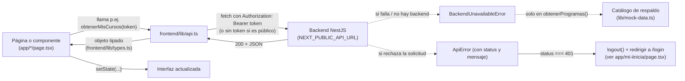

# Código explicado: Frontend de IINICIA

Documentación en español, pensada para alguien sin conocimiento previo del sistema, de cada archivo del frontend (`frontend/`, Next.js + TypeScript + Tailwind) que tiene lógica real: qué hace y, sobre todo, **por qué** está hecho así. Cada archivo fuente tiene su propio `.md`, en la misma ruta relativa dentro de `docs/codigo-explicado/frontend/`.

Contexto general del proyecto: ver `CLAUDE.md` en la raíz del repositorio (stack, reglas de seguridad, roles, alcance de la primera entrega).

## Páginas (`frontend/app/`)

- [`app/layout.tsx`](./app/layout.md) — el molde que envuelve toda la app: fuentes, header, footer, `AuthProvider` y metadatos de SEO.
- [`app/page.tsx`](./app/page.md) — la landing pública (home): hero, acreditación, oferta académica, testimonios, admisiones, noticias, FAQ y contacto.
- [`app/login/page.tsx`](./app/login/page.md) — inicio de sesión en dos pasos (correo/contraseña + código de 6 dígitos), con diagrama del flujo de 2FA.
- [`app/registro/page.tsx`](./app/registro/page.md) — alta de un aspirante nuevo, con sesión automática al terminar.
- [`app/recuperar/page.tsx`](./app/recuperar/page.md) — paso 1 de "olvidé mi contraseña": pide el correo sin revelar si existe una cuenta con él.
- [`app/restablecer/page.tsx`](./app/restablecer/page.md) — paso 2: define la nueva contraseña usando el enlace que llegó por correo.
- [`app/mi-iinicia/page.tsx`](./app/mi-iinicia/page.md) — el panel "Mi Campus", distinto según el rol (estudiante, profesor, aspirante, admin/coordinador), con el SSO real a Moodle. El archivo más grande y complejo del frontend.
- [`app/admin/materias/page.tsx`](./app/admin/materias/page.md) — administración de materias y su seriación (prerequisitos) por carrera.
- [`app/admin/programas/page.tsx`](./app/admin/programas/page.md) — catálogo de programas académicos y su curso de Moodle asociado.
- [`app/admin/usuarios/page.tsx`](./app/admin/usuarios/page.md) — el panel administrativo más grande: roles, ámbito de coordinador, matrícula en Moodle, revisión de documentos y notificaciones push.

## Lógica compartida (`frontend/lib/`)

- [`lib/api.ts`](./lib/api.md) — el único archivo que habla por HTTP con el backend; todas las páginas pasan por aquí.
- [`lib/auth-context.tsx`](./lib/auth-context.md) — guarda la sesión del usuario (token + datos) y la expone con `useAuth()`.
- [`lib/types.ts`](./lib/types.md) — los tipos de TypeScript que describen cada dato que viaja entre frontend y backend.

## Componentes de interfaz (`frontend/components/`)

- [`components/ui/input.tsx`](./components/ui/input.md) — campo de texto con mostrar/ocultar contraseña.
- [`components/ui/select.tsx`](./components/ui/select.md) — menú desplegable con el mismo lenguaje visual que `Input`.
- [`components/ui/count-up.tsx`](./components/ui/count-up.md) — anima un número hacia su valor real al entrar en vista.
- [`components/ui/progress-bar.tsx`](./components/ui/progress-bar.md) — barra de progreso animada al entrar en vista.
- [`components/ui/network-background.tsx`](./components/ui/network-background.md) — fondo animado de puntos conectados (canvas) del hero.
- [`components/ui/reveal.tsx`](./components/ui/reveal.md) — revela contenido con fade/zoom al hacer scroll, usando `IntersectionObserver`.
- [`components/ui/scroll-progress.tsx`](./components/ui/scroll-progress.md) — línea fija arriba que marca cuánto se ha recorrido de la página.
- [`components/layout/site-header.tsx`](./components/layout/site-header.md) — encabezado fijo con menú, scroll-spy y enlaces según rol/sesión.
- [`components/layout/site-footer.tsx`](./components/layout/site-footer.md) — pie de página institucional.

## Qué se dejó fuera, y por qué

- **Archivos `*.test.tsx` / `*.test.ts`**: son pruebas automatizadas, no lógica de producto; no se documentan como código explicado (su propósito ya es evidente: verificar el comportamiento del archivo que acompañan).
- **`frontend/lib/mock-data.ts`**: son solo datos de ejemplo (programas, dashboard de estudiante de muestra) usados como respaldo visual mientras el backend no expone cierta información o no responde. Se menciona de paso en los docs de las páginas que lo usan (`app/page.tsx`, `app/registro/page.tsx`, `app/mi-iinicia/page.tsx`), pero no tiene su propio `.md` porque no tiene lógica, solo datos fijos.
- **Componentes puramente presentacionales**: `components/ui/badge.tsx`, `components/ui/icon.tsx`, `components/ui/card.tsx`, `components/ui/button.tsx` y `components/ui/section-bg.tsx` se revisaron y **no tienen estado, efectos ni lógica de decisión**: son funciones que solo combinan clases de Tailwind según props simples (variante de color, si es "hoverable", etc.) y devuelven el `
`/``/`<button>` correspondiente. No se les hizo un `.md` propio porque no habría nada que "explicar" más allá de leer el propio archivo (unas pocas líneas de clases condicionales).

## Cómo fluye una petición: de la página al backend

Casi todas las pantallas del portal siguen el mismo camino para pedir o mandar datos reales: la página llama a una función de `lib/api.ts`, esa función hace el `fetch` con la URL y el token correctos, y el backend responde con JSON que la página usa para actualizar su estado con `useState`.

El backend es siempre quien decide si una operación está permitida para el rol que hace la llamada; el frontend solo oculta o redirige por conveniencia de interfaz (regla del proyecto: "los permisos se validan en el backend, no solo en la interfaz"). El token de Moodle nunca aparece en ningún paso de este diagrama: el backend lo usa internamente y solo entrega al frontend URLs de SSO de un solo uso o datos ya procesados.
