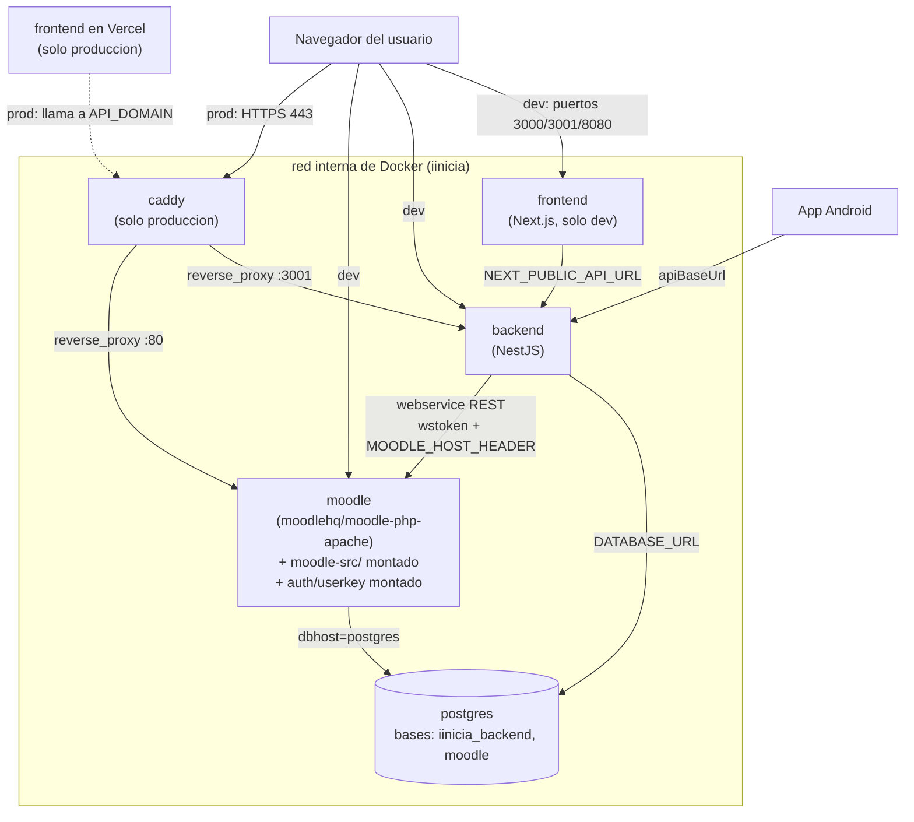

# Código explicado — `infrastructure/`

Documentación en español, pensada para alguien sin conocimiento previo del sistema, de la infraestructura Docker y del plugin de Moodle propios de IINICIA. Sigue la regla de CLAUDE.md: "No modificar el core de Moodle" — por eso toda la integración vive en un plugin separado (`moodle-custom/`), montado encima de un checkout sin versionar del core (`moodle-src/`), nunca parcheado dentro de él.

## Docker Compose

- [`docker-compose.md`](./docker-compose.md) — cubre `docker-compose.yml`, `docker-compose.override.yml`, `docker-compose.prod.yml`, `.env.example` y `.env.prod.example` juntos: qué servicios se levantan (Postgres, Moodle, backend, y Caddy en producción), cómo se conectan entre sí por la red interna de Docker, la diferencia entre desarrollo (hot-reload, puertos abiertos) y producción (imagen compilada, solo Caddy público con HTTPS), y qué variables de entorno existen y para qué sirve cada una.

## Plugin de Moodle `auth_userkey` (SSO portal → Moodle)

Mecanismo de login único: el estudiante hace clic en "Entrar al Campus" en el portal y cae dentro de Moodle ya autenticado, sin ver ni escribir una segunda contraseña, y sin que el token de Moodle salga nunca del backend (regla de CLAUDE.md: "Ningún token de Moodle en React ni en Android; solo en el backend").

- [`moodle-plugin/auth.md`](./moodle-plugin/auth.md) — la clase `auth_plugin_userkey`: genera/valida llaves de un solo uso y abre la sesión de Moodle; nunca acepta usuario/contraseña.
- [`moodle-plugin/externallib.md`](./moodle-plugin/externallib.md) — expone `get_login_url()` como la función de Web Service `auth_userkey_request_login_url`, la que el backend llama por HTTP.
- [`moodle-plugin/login.md`](./moodle-plugin/login.md) — endpoint HTTP al que llega el navegador del usuario para consumir la llave y quedar logueado.
- [`moodle-plugin/logout.md`](./moodle-plugin/logout.md) — endpoint HTTP simétrico para cerrar sesión; parte del plugin, pero no conectado hoy a ningún flujo activo del backend.
- [`moodle-plugin/core_userkey_manager.md`](./moodle-plugin/core_userkey_manager.md) — crea, valida y borra las llaves, reutilizando el mecanismo nativo `user_private_key` del core de Moodle.
- [`moodle-plugin/userkey_manager_interface.md`](./moodle-plugin/userkey_manager_interface.md) — el contrato que permite sustituir el gestor de llaves real por un doble de prueba en PHPUnit.
- [`moodle-plugin/services.md`](./moodle-plugin/services.md) — registra la función de Web Service ante Moodle (nombre público, clase PHP real, permiso requerido).
- [`moodle-plugin/access.md`](./moodle-plugin/access.md) — define el permiso `auth/userkey:generatekey`, que ningún rol tiene por default: hay que otorgarlo explícitamente a la cuenta de servicio del backend.
- [`moodle-plugin/settings.md`](./moodle-plugin/settings.md) — la pantalla de configuración dentro de Moodle; casi todos los valores quedan en su default de fábrica a propósito, porque la lógica de negocio real vive en el backend.

### Lo que se dejó fuera, y por qué

- **`infrastructure/moodle-src/`** — es un checkout completo de terceros del código fuente de Moodle (~700 MB, miles de archivos, no versionado en git). No es código propio del proyecto; documentarlo archivo por archivo no tendría valor y violaría la regla de no tocar/documentar el core como si fuera nuestro.
- **`moodle-custom/auth/userkey/tests/` y `pix/`** — `tests/` son las 76 pruebas PHPUnit heredadas del plugin de Catalyst (confirmadas en verde el 2026-11-25, ver `presentacion/pruebas-moodle.pdf`); `pix/` es solo el ícono del plugin. Ninguno aporta lógica de negocio que documentar.
- **`db/upgrade.php`, `version.php`, `lang/`, `classes/privacy/provider.php`** — boilerplate estándar de cualquier plugin de Moodle: `upgrade.php` orquesta migraciones entre versiones (aquí vacío de pasos reales), `version.php` solo declara número de versión y compatibilidad, `lang/` son las cadenas de texto en inglés/español que los demás archivos referencian con `get_string()`, y `provider.php` declara ante el sistema de privacidad de Moodle que este plugin no almacena datos personales propios más allá de lo que el core ya gestiona. Se mencionan aquí en una línea, sin `.md` propio, porque no contienen decisiones de diseño específicas de IINICIA.

## Diagrama de contenedores

En desarrollo, `postgres`, `moodle`, `backend` y `frontend` publican sus puertos directamente al host (3000/3001/5432/8080) y el navegador habla con cada uno por separado. En producción, solo `caddy` publica 80/443 — todo lo demás vive exclusivamente dentro de la red interna de Docker, y `caddy` enruta por nombre de dominio (`API_DOMAIN` → backend, `CAMPUS_DOMAIN` → Moodle); el frontend se despliega aparte en Vercel.
