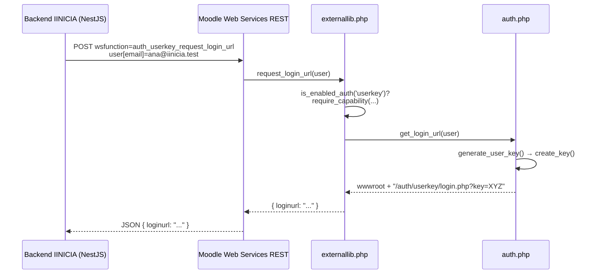

# `infrastructure/moodle-custom/auth/userkey/externallib.php`

**En una frase:** expone `get_login_url()` de `auth.php` como una función de Web Service de Moodle, para que un sistema externo (el backend de IINICIA) pueda pedir por HTTP una URL de login de un solo uso.

## Por qué existe

Todo lo que hace `auth.php` (generar y validar llaves) vive **dentro** de Moodle, en PHP, en el mismo proceso. Pero el backend de IINICIA es un servicio NestJS totalmente separado, corriendo en otro contenedor, que solo puede hablar con Moodle por HTTP. Moodle resuelve esto con su framework de "Web Services": cualquier función que se quiera exponer a un llamador externo se envuelve en una clase que extiende `external_api`, con tres métodos (parámetros, lógica, estructura de retorno) y se registra en `db/services.php` (ver `services.md`). Este archivo es exactamente ese envoltorio para `auth_userkey`.

Sin este archivo, la funcionalidad de `auth.php` solo sería usable desde dentro del propio Moodle (por ejemplo, otro plugin PHP) — nunca desde el backend de IINICIA.

## Recorrido del código

```php
require_once($CFG->dirroot . "/auth/userkey/auth.php");

class auth_userkey_external extends external_api {
```

`extends external_api` es el requisito de Moodle para que una clase pueda registrarse como "clase de servicio web". El `require_once` trae la clase `auth_plugin_userkey` de `auth.php`, porque la lógica real vive ahí — este archivo es deliberadamente delgado, solo traduce entre "llamada de Web Service" y "llamada a métodos del plugin de auth".

```php
    public static function request_login_url_parameters() {
        return new external_function_parameters(
            [
                'user' => new external_single_structure(
                    get_auth_plugin('userkey')->get_request_login_url_user_parameters()
                ),
            ]
        );
    }
```

Moodle exige declarar, con tipos exactos, qué parámetros espera cada función de Web Service — es la validación de entrada del lado de Moodle (análoga a los DTOs/validadores del backend de NestJS). Aquí se delega a `get_request_login_url_user_parameters()` del propio plugin de auth, que a su vez depende de qué campo de mapeo esté configurado (por default, `email` — ver `settings.md`). Esto significa que la forma exacta del parámetro `user` (¿espera `email`? ¿`username`? ¿`id`?) cambia según cómo esté configurado `auth_userkey`, sin tener que editar este archivo.

```php
    public static function request_login_url($user) {
        if (!is_enabled_auth('userkey')) {
            throw new webservice_access_exception(get_string('pluginisdisabled', 'auth_userkey'));
        }

        $context = context_system::instance();
        require_capability('auth/userkey:generatekey', $context);

        $auth = get_auth_plugin('userkey');
        $loginurl = $auth->get_login_url($user);

        return [
            'loginurl' => $loginurl,
        ];
    }
```

Esta es la función que el backend de IINICIA termina ejecutando de verdad, vía `wsfunction=auth_userkey_request_login_url` en la llamada REST. Dos verificaciones de seguridad **antes** de generar nada:

1. `is_enabled_auth('userkey')`: si alguien deshabilitara este método de autenticación desde el panel de Moodle, la función deja de funcionar inmediatamente, aunque el token del web service siga siendo válido — un segundo "interruptor" independiente del token.
2. `require_capability('auth/userkey:generatekey', ...)`: el usuario propietario del **token** con el que se llama (no el usuario que va a iniciar sesión, sino la cuenta de servicio del backend — normalmente `admin`) debe tener el permiso `auth/userkey:generatekey` explícitamente otorgado (ver `access.md`). Sin este permiso, aunque el token sea válido para otras funciones del servicio, esta llamada específica se rechaza.

Si ambas pasan, delega en `$auth->get_login_url($user)` — exactamente el método de `auth.php` ya documentado — y envuelve el resultado en el array `['loginurl' => ...]` que Moodle serializa a JSON para la respuesta REST.

```php
    public static function request_login_url_returns() {
        return new external_single_structure(
            [
                'loginurl' => new external_value(PARAM_RAW, 'Login URL for a user to log in'),
            ]
        );
    }
```

Declara la forma exacta de la respuesta (un objeto con una sola clave `loginurl`, de tipo texto sin filtrar — `PARAM_RAW` porque es una URL completa, no un campo de texto simple). Moodle usa esta declaración para validar que la función no devuelva algo con una forma distinta a la prometida, y para generar su documentación automática de Web Services.

## Conexión con el resto del sistema

Esta es la pieza que el backend llama directamente. `backend/src/moodle/moodle.service.ts`, método `solicitarUrlAutologin`, hace una petición POST a `webservice/rest/server.php` con `wsfunction: 'auth_userkey_request_login_url'` y `user[email]: <correo del usuario>`. La respuesta JSON (`{ loginurl: "..." }`) es exactamente la estructura que `request_login_url_returns()` define aquí. El backend nunca ve ni toca llaves, tablas de Moodle o sesiones — solo pide una URL y la usa una vez para redirigir al navegador del usuario.



## Cosas que no son obvias a primera vista

- **Dos capas de permisos independientes.** Que el token del backend esté autorizado para el servicio `iinicia_backend` (ver `services.php` general del proyecto) no basta: también necesita el `capability` específico `auth/userkey:generatekey` asignado al rol de la cuenta que posee ese token (típicamente `admin`). Esto limita el "radio de explosión" si el token se filtrara: solo sirve para lo que esa cuenta puede hacer, función por función.
- **El tipo exacto del parámetro `user` es dinámico.** No está hardcodeado a "email" en este archivo — depende de la configuración del plugin (`mappingfield`). Si alguien cambiara esa configuración sin avisar al equipo de backend, las llamadas actuales (que mandan `user[email]`) empezarían a fallar con un error de parámetro inválido, no un error silencioso.
