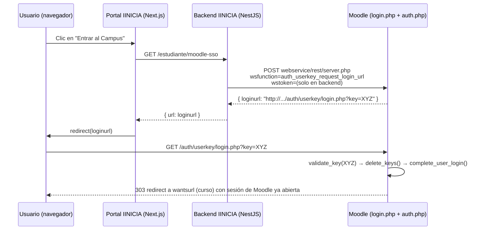

# `infrastructure/moodle-custom/auth/userkey/login.php`

**En una frase:** el endpoint HTTP (`/auth/userkey/login.php?key=...`) al que llega el navegador del estudiante para consumir la llave de un solo uso y quedar logueado en Moodle.

## Por qué existe

Todo lo que hace `auth.php` (validar la llave, abrir la sesión) necesita un punto de entrada HTTP real para que el navegador del usuario pueda llegar ahí con un simple `GET`. Moodle no expone automáticamente los métodos de un plugin de auth como URLs — cada plugin que lo necesite debe traer su propio archivo "frontal" que arranque el entorno de Moodle (`config.php`) y llame al método correspondiente. Este archivo, de solo 7 líneas útiles, es ese punto de entrada para el login.

## Recorrido del código

```php
require_once(dirname(__FILE__) . '/../../config.php');

if (!is_enabled_auth('userkey')) {
    throw new moodle_exception(get_string('pluginisdisabled', 'auth_userkey'));
}

get_auth_plugin('userkey')->user_login_userkey();
```

Tres pasos, en orden:

1. `require_once(... '/../../config.php')` carga el arranque completo de Moodle (conexión a base de datos, sesiones, configuración global `$CFG`) — necesario porque este archivo se ejecuta como un script PHP independiente, no dentro de un flujo de Moodle ya iniciado. La ruta relativa (`../../`) sube desde `auth/userkey/` hasta la raíz donde vive `config.php`, el archivo de arranque real de la instalación (el mismo que todas las páginas de Moodle cargan primero).
2. Verifica que el método de autenticación `userkey` esté habilitado en este Moodle. Esta es una segunda comprobación de seguridad, redundante a propósito con la que ya hace `externallib.php` al generar la llave: si alguien deshabilitara `auth_userkey` *después* de que una llave ya se generó pero *antes* de que se use, esta verificación bloquea el acceso igual.
3. Delega todo el trabajo real a `get_auth_plugin('userkey')->user_login_userkey()` (documentado en detalle en `auth.md`). `get_auth_plugin('userkey')` es la función interna de Moodle que instancia (o reutiliza) la clase `auth_plugin_userkey` de `auth.php`.

No hay más lógica aquí a propósito: este archivo es solo el "cable" entre una URL pública y el método que hace el trabajo.

## Conexión con el resto del sistema

Este archivo no lo llama el backend de IINICIA directamente — lo llama el **navegador del usuario**, siguiendo la URL que el backend generó vía `MoodleService.solicitarUrlAutologin` → `auth_userkey_request_login_url` (ver `externallib.md`). El flujo completo:



El punto clave: el navegador del usuario nunca ve el token de Moodle (`wstoken`), solo ve la llave de un solo uso (`key`) dentro de esta URL — y esa llave ya no sirve para nada una vez usada.

## Cosas que no son obvias a primera vista

- **Por qué la llave viaja en la URL y no es un problema de seguridad grave si queda en el historial del navegador o en logs del servidor.** La llave expira en segundos (default 60s, configurable en `settings.php`) y se borra de la base de datos en el primer uso (`delete_keys()` dentro de `auth.php`). Aunque alguien la viera en un log de acceso o en el historial, probablemente ya estaría vencida o ya consumida.
- **Este archivo es idéntico, carácter por carácter, al de cualquier instalación del plugin `auth_userkey` de Catalyst** — no tiene nada específico de IINICIA. Toda la personalización vive en la configuración (`settings.php`) y en cómo el backend lo invoca, nunca en este archivo.
